# Developer Knowledge Reference: Feature-Oriented Layered UI

## Page 1: Purpose

This is a reusable development reference for building modular React and
TypeScript interfaces. The GemsForgeAPI Console is the applied example, but the
principles, diagrams, decision rules, and links are intended to be useful for
future projects as well.

The architecture separates feature intent, reusable presentation, client
workflows, server state, transport, and typed data contracts.

The goal is to make the product easier to expand and redesign. A visual UX
redesign should not require rewriting API behavior, schema contracts, or every
feature screen.

## Recommended description

The Console uses a **feature-oriented layered UI architecture** based on:

- separation of concerns;
- the Single Responsibility Principle;
- component composition;
- typed data contracts;
- custom hooks for feature workflows; and
- a dedicated server-state/query layer.

This is influenced by Clean Architecture, but it is not a strict backend Clean
Architecture implementation. The UI version focuses on ownership, dependency
direction, replaceable visual layers, and feature boundaries.

## Architecture map

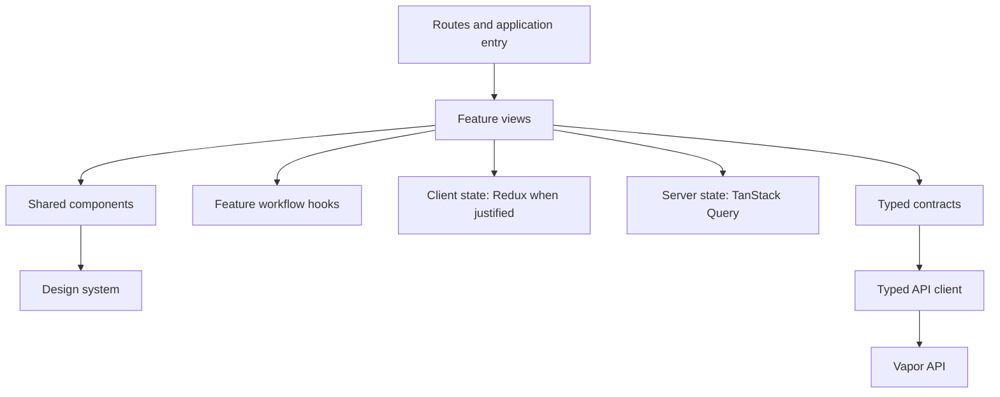

## Current Console layers

| Layer | Current location | Responsibility |
| --- | --- | --- |
| Application entry | `Console/src/main.tsx`, `App.tsx` | Bootstrapping, providers, and the application shell. |
| Navigation | `Console/src/routes/` | Exact URLs, route parameters, feature loading, and recovery boundaries. |
| Feature modules | `Console/src/features/` | Feature screens, domain intent, feature composition, and feature-specific controls. |
| Workflow hooks | `Console/src/hooks/` | Multi-step workflows, reducers, temporary state, editing, paging, and uploads. |
| Shared UI primitives | `Console/src/components/ui/` | Reusable visual structure, semantics, accessibility, and behavior. |
| Shared application patterns | `Console/src/components/`, `components/layout/` | Shell, record collections, imports, attachments, feedback, and recurring layouts. |
| Design system | `Console/src/design-system/` | Tamagui tokens, themes, typography, spacing, and responsive rules. |
| Server state | `Console/src/data/` | TanStack Query keys, reads, mutations, caching, loading, errors, and invalidation. |
| Transport | `Console/src/api.ts` | HTTP requests, response parsing, cancellation, uploads, binaries, and `APIError`. |
| Contracts | `Console/src/types.ts` | Request, response, record, create-payload, and schema types. |
| Native boundary | `Console/src/bridge/` | Typed React-to-SwiftUI communication. |
| Table capability | `Console/src/table-kit/` | Reusable table, selection, query, and import behavior. |
| Authentication | `Console/src/auth/` | Session, sign-in, reset-password, and protected-route behavior. |

## Responsibility rule

Feature code provides **values and user intent**. Shared components provide
**structure and behavior**.

For example:

```tsx
<GemEmptyState
  icon="✦"
  title="No education records"
  description="The Education table did not return any records."
/>
```

The feature supplies the meaning. `GemEmptyState` owns the markup, semantics,
accessibility, spacing, and visual treatment.

Each module should have one primary reason to change:

- `GemDataTable` changes when table structure or table accessibility changes.
- `EducationView` changes when the Education feature’s composition changes.
- `useSchemaBuilder` changes when the schema-building workflow changes.
- `recordQueries.ts` changes when server reads, mutations, or invalidation change.
- `types.ts` changes when the data contract changes.
- `tamagui.config.ts` changes when the visual system changes.

## Redux placement

Redux is an optional **client/application-state layer**. It should not replace
TanStack Query or become a general-purpose storage location for every value.

### 🧭 GemsForgeAPI Console reference

This handbook uses the GemsForgeAPI Console as its applicable reference
application. The current Console uses `@tanstack/react-query` for server state,
feature query modules under `Console/src/data/`, and a shared `QueryClient`.
It does not currently use RTK Query. When reading this handbook for the
Console, follow that established implementation rather than introducing a
second server-state library.

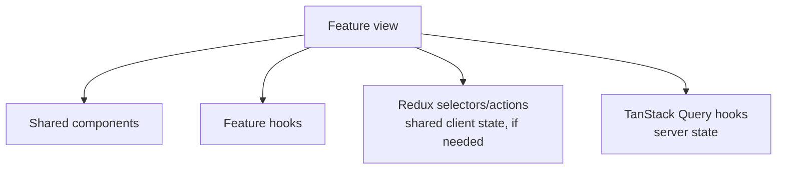

### Redux owns

- shared workspace or navigation state;
- multi-screen workflows;
- offline queues;
- cross-feature selections;
- undo/redo history;
- durable client drafts; or
- global UI coordination that has outgrown feature-local hooks.

### Redux does not own

- API records that TanStack Query already caches;
- loading and error state for server requests;
- one dialog’s open state;
- a selected row used by one screen;
- a local form draft; or
- derived values that can be calculated from existing state.

The decision rule is:

> Redux owns durable or cross-feature client state. TanStack Query owns server
> state. Local React state and feature hooks own short-lived state that has no
> reason to leave the feature.

## Growth and UX redesign

This architecture supports UX redesign by keeping visual concerns replaceable:

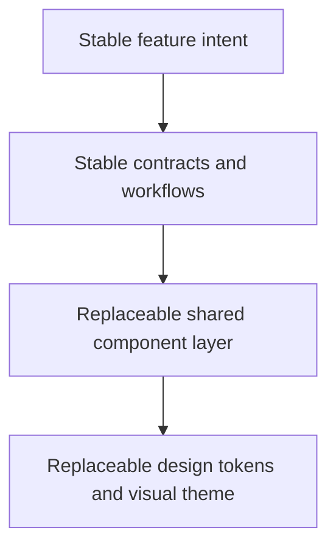

Changing the visual language should primarily affect shared components and the
design system. Changing a feature’s API behavior should primarily affect its
data module or workflow hook. Changing a server response should primarily
affect the contract, API mapping, and affected feature consumers.

## Adding a new feature

Start with a feature boundary rather than adding unrelated files to a global
folder:

```text
features/example/
├── ExampleView.tsx
├── exampleTypes.ts          # only if feature-specific
├── exampleQueries.ts        # feature server-state behavior
├── useExampleWorkflow.ts    # only if workflow state is needed
└── components/              # only feature-specific components
```

Use shared `components/` only when a pattern has repeated structure,
accessibility behavior, interaction behavior, or a stable semantic API. Do not
extract a wrapper merely to hide one `div`.

## Useful search terms

- `feature-oriented frontend architecture React`
- `layered frontend architecture React TypeScript`
- `separation of concerns React custom hooks`
- `React component composition architecture`
- `server state versus client state React`
- `Feature-Sliced Design frontend`
- `Redux versus TanStack Query server state`

## Learning path

When a codebase starts feeling tangled, work through these questions in order:

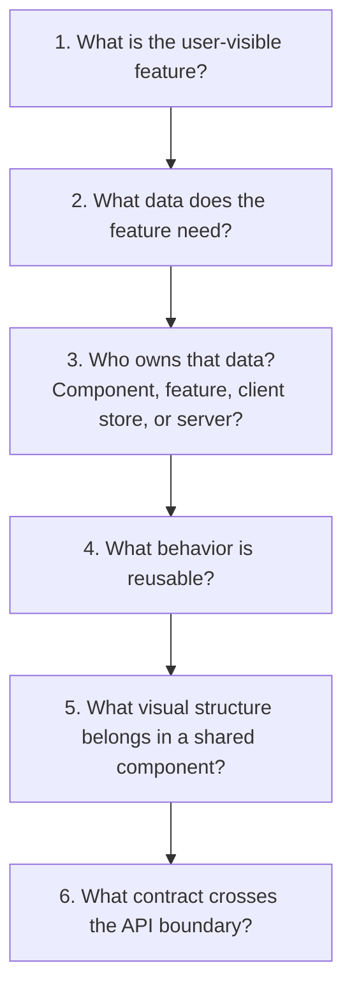

### State ownership decision guide

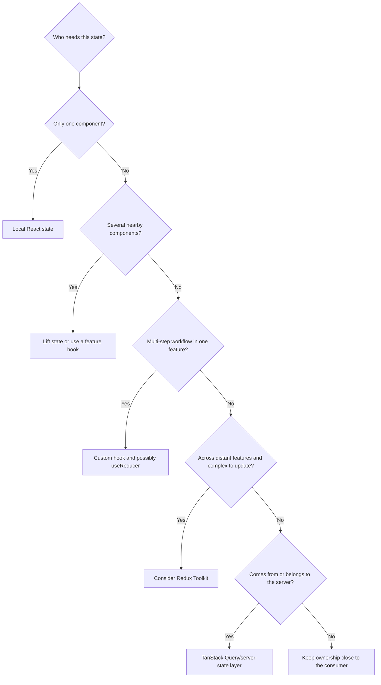

### Component extraction decision guide

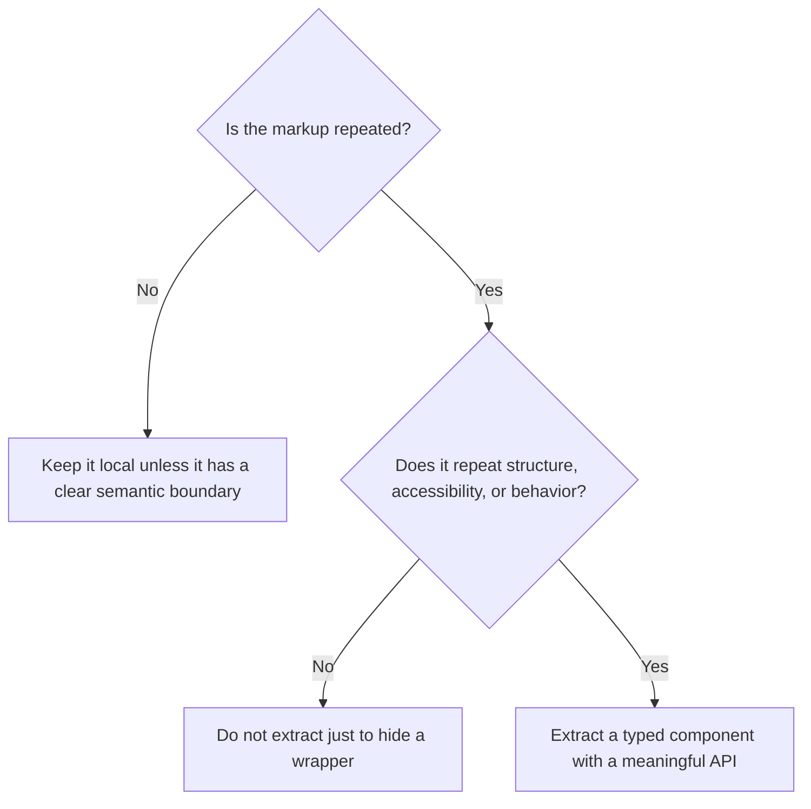

## Live examples and interactive references

These resources are useful when the concepts are easier to understand by
editing and running an example:

- [Thinking in React](https://react.dev/learn/thinking-in-react) — interactive
  component decomposition and minimal state exercises.
- [Sharing State Between Components](https://react.dev/learn/sharing-state-between-components)
  — live controlled/uncontrolled component examples and lifting state.
- [React Managing State](https://react.dev/learn/managing-state) — interactive
  examples for reducers, state structure, and scaling state management.
- [Redux Fundamentals](https://redux.js.org/tutorials/fundamentals/part-1-overview)
  — an incremental working Redux example showing actions, reducers, and store
  data flow.
- [Redux Toolkit Quick Start](https://redux.js.org/tutorials/quick-start) —
  the recommended modern Redux setup with a runnable example.
- [TanStack Query examples](https://tanstack.com/query/latest/docs/framework/react/examples/basic)
  — live examples of queries, mutations, caching, and invalidation.
- [Storybook examples](https://storybook.js.org/docs/get-started/examples) —
  component-driven examples for developing visual components independently.
- [CodeSandbox React templates](https://codesandbox.io/templates/react) —
  disposable browser projects for trying a pattern without changing a real
  repository.

## Reference material

- [React: Thinking in React](https://react.dev/learn/thinking-in-react)
- [React: Managing State](https://react.dev/learn/managing-state)
- [React: Sharing State Between Components](https://react.dev/learn/sharing-state-between-components)
- [Redux: Getting Started](https://redux.js.org/introduction/getting-started)
- [Redux Toolkit overview](https://redux.js.org/redux-toolkit/overview/)
- [TanStack Query overview](https://tanstack.com/query/latest/docs/framework/react/overview)
- [React Router documentation](https://reactrouter.com/home)
- [Tamagui documentation](https://tamagui.dev/docs/intro/introduction)
- [Zod documentation](https://zod.dev/)
- [Martin Fowler: Flag Argument](https://martinfowler.com/bliki/FlagArgument.html)
- [React legacy Composition vs. Inheritance](https://legacy.reactjs.org/docs/composition-vs-inheritance.html) — historical context; prefer current React composition guidance for new work.
- [Feature-Sliced Design overview](https://fsd.how/docs/get-started/overview/)
- [Presentational-Container Pattern](https://www.patterns.dev/react/presentational-container-pattern/)

## Repository references

- [`Console/ARCHITECTURE.md`](../../../../GemsForgeAPI/Console/ARCHITECTURE.md)
- [`Console/UI_STANDARDS.md`](../../../../GemsForgeAPI/Console/UI_STANDARDS.md)
- [`Console/COMPONENT_API.md`](../../../../GemsForgeAPI/Console/COMPONENT_API.md)
- [`Console/README.md`](../../../../GemsForgeAPI/Console/README.md)

---

## Page 2: Envisioning Boundaries Before Coding

## Purpose

Before creating a file, decide what responsibility it will own. The goal is
not to predict every future file or force a rigid folder structure. The goal is
to make the boundary visible before implementation begins.

The guiding question is:

> If this behavior changes later, what should be the smallest set of files that
> needs to change?

If the answer is “the whole feature,” the boundary may still be too broad. If
the answer is “a tiny, clearly named module,” the responsibility is probably
well placed.

## The responsibility map

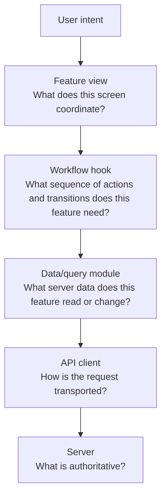

At the same time:

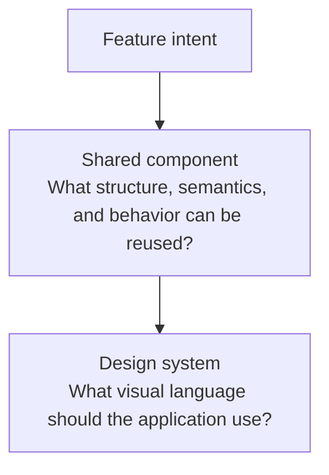

## File responsibility cards

### Feature view

Example: `EducationView.tsx`

The feature view is the coordinator for one user-facing capability.

It may:

- choose which feature components to render;
- connect feature hooks and query hooks;
- pass values and event handlers into components;
- coordinate selection, layout, and feature-level empty states;
- translate user intent into workflow calls.

It should not:

- construct raw API URLs;
- duplicate shared loading, error, or empty-state markup;
- own an unrelated feature workflow;
- define generic visual primitives;
- become the permanent home for every detail component.

### Workflow hook

Example: `useSchemaBuilder.ts`

The workflow hook owns a feature’s behavior over time.

It may:

- use `useState` or `useReducer`;
- validate draft input;
- expose commands such as `addColumn`, `previewTable`, or `createTable`;
- coordinate asynchronous operations;
- protect against stale responses or duplicate submissions;
- return a view-ready state and actions.

It should not:

- render JSX;
- define the application’s visual styling;
- duplicate the query cache;
- silently bypass server authority.

### Data/query module

Example: `data/lifeQueries.ts` or `data/workflowQueries.ts`

The data layer owns server state.

It may:

- define query keys;
- call the typed API client;
- configure queries and mutations;
- manage cancellation, caching, retries, and invalidation;
- expose server data to feature views and hooks.

It should not:

- render components;
- decide page layout;
- store temporary visual state;
- become a second Redux store.

### Shared component

Example: `components/ui/GemEmptyState.tsx`

The shared component owns a recurring interface pattern.

It may:

- define semantic markup;
- provide accessibility behavior;
- own repeated interaction behavior;
- accept typed, meaningful props;
- use design-system tokens.

It should not:

- know which feature fetched its data;
- construct feature-specific requests;
- import feature views;
- accept implementation details as its public API.

### Contract or schema module

Example: `types.ts` or a future feature-local `schemaTypes.ts`

The contract module defines the shape of information crossing a boundary.

It may define:

- API response types;
- create and patch payloads;
- schema-builder column definitions;
- finite status or variant types;
- mappings between server and UI representations.

It should not:

- render UI;
- perform requests;
- contain component state;
- become a miscellaneous collection of unrelated helper functions.

## Before-and-after responsibility thinking

### Too broad

```text
EducationView.tsx
├── fetches records
├── defines query keys
├── validates forms
├── renders every field
├── owns generic buttons
├── handles uploads
└── formats API errors
```

### Better boundary map

```text
EducationView.tsx
    └── coordinates the Education screen

useEducationWorkflow.ts
    └── owns Education-specific editing behavior

data/recordQueries.ts
    └── owns Education reads and mutations

EducationDetail.tsx
    └── renders Education-specific detail structure

EditableRecordFields.tsx
    └── owns the reusable editable-field pattern

GemEmptyState.tsx
    └── owns the reusable empty-state pattern

types.ts
    └── owns Education data contracts
```

## A design exercise before implementation

For every new feature, write this small map before writing JSX:

```text
Feature: ______________________________

User outcome:
_______________________________________

Feature view owns:
_______________________________________

Workflow hook owns:
_______________________________________

Server data/query module owns:
_______________________________________

Shared components needed:
_______________________________________

Contracts or schemas needed:
_______________________________________

Local state only:
_______________________________________

Cross-feature state, if any:
_______________________________________
```

Then test each proposed file with three questions:

1. What is this file’s one primary responsibility?
2. What is this file explicitly not responsible for?
3. What other file would change if this responsibility changed?

## Applied Console example

For the schema builder, the boundary map is:

```text
SchemaBuilderView.tsx
    └── renders the schema-building experience

useSchemaBuilder.ts
    └── owns draft state, validation, approval, and workflow transitions

data/workflowQueries.ts
    └── owns guidance, preview, creation, and import requests

types.ts
    └── owns TableBuilderColumn, TableBuilderRequest, and preview contracts

LiveSchemaView.tsx
    └── renders live schema inspection

Tamagui/design-system
    └── owns reusable visual language
```

This map can be designed before deciding whether a responsibility belongs in a
new file, a feature-local module, a shared component, or Redux. The architecture
therefore becomes a planning tool, not merely a description of code that has
already been written.

---

## Page 3: Crafting Reusable View Components

## The purpose of a reusable view

A reusable view component should reuse a **screen pattern** without erasing the
meaning of the feature using it.

```text
GemDataTable
    reusable visual primitive

RecordCollectionView
    reusable application-level view pattern

EducationView
    feature-specific view
```

The reusable view owns the common structure. The feature supplies the meaning,
data, labels, and feature-specific choices.

## What belongs in a reusable view

A collection-oriented view may own:

- page heading and description placement;
- loading, empty, and error states;
- search, sorting, filtering, and pagination regions;
- list/detail or master/detail layout;
- toolbar and action slots;
- stable accessibility structure;
- responsive behavior for the common layout.

The feature should still supply:

- the record type;
- labels and descriptions;
- columns and display values;
- empty-state copy;
- detail rendering;
- create and import actions;
- feature-specific query and workflow behavior.

## Generic view pattern

```tsx
interface RecordCollectionViewProps<TRecord> {
  title: string;
  description?: string;
  records: TRecord[];
  isLoading: boolean;
  error?: Error | null;
  getKey: (record: TRecord) => string;
  renderRecord: (record: TRecord) => ReactNode;
  renderDetail: (record: TRecord) => ReactNode;
  emptyState: ReactNode;
  toolbar?: ReactNode;
}
```

The reusable view owns the screen structure:

```tsx
export function RecordCollectionView<TRecord>({
  title,
  description,
  records,
  isLoading,
  error,
  getKey,
  renderRecord,
  renderDetail,
  emptyState,
  toolbar,
}: RecordCollectionViewProps<TRecord>) {
  if (isLoading) return <GemLoadingState label={`Loading ${title}`} />;
  if (error) return <QueryFeedback error={error} />;
  if (records.length === 0) return emptyState;

  return (
    <section>
      <GemSectionHeader title={title} description={description}>
        {toolbar}
      </GemSectionHeader>

      <div className="record-layout">
        <div>
          {records.map((record) => (
            <div key={getKey(record)}>{renderRecord(record)}</div>
          ))}
        </div>

        <aside>{records[0] && renderDetail(records[0])}</aside>
      </div>
    </section>
  );
}
```

The feature view supplies the feature meaning:

```tsx
<RecordCollectionView
  title="Education"
  description="Read education history from Gem Life."
  records={paging.items}
  isLoading={false}
  getKey={(record) => record.id}
  renderRecord={(record) => (
    <GemRecordCard
      title={record.institutionName}
      subtitle={record.educationType}
      status={record.status}
    />
  )}
  renderDetail={(record) => <EducationDetail record={record} />}
  emptyState={
    <GemEmptyState
      title="No education records"
      description="The Education table did not return any records."
    />
  }
/>
```

## The three-level boundary

```text
Reusable view component
    owns screen structure and common states

Feature view
    owns feature meaning and feature-specific choices

Shared primitives
    own individual visual and interaction patterns
```

This allows a UX redesign to change the collection layout while keeping the
Education, Employment, Address, and Transaction features responsible for their
own meaning and data decisions.

## Choosing a name

Names should describe the reusable pattern rather than the implementation:

- `RecordCollectionView`
- `ResourceListView`
- `FeaturePageLayout`
- `MasterDetailView`
- `DataCollectionView`

For the Console, `RecordCollectionView` is the strongest starting name because
the same collection pattern appears across Education, Employment, Addresses,
and Transactions.

## Guardrail: avoid the universal page component

Do not create one component with dozens of boolean flags and feature-specific
exceptions:

```tsx
<UniversalPage
  hasAttachments
  supportsCSV
  showDomainSidebar
  isEducation
  isTransaction
  enableLegacyMode
  useCompactTable
/>
```

Prefer typed render props, named slots, and feature composition. A reusable view
should provide a stable structure while leaving meaningful decisions to the
feature that owns them.

### 📝 The same warning applies to forms

The universal-page problem can quietly become a universal-form problem. A shared
form shell is useful; a single form that learns every resource’s fields, schema,
payload rules, and feature exceptions is not.

```tsx
<UniversalForm
  isEducation
  isEmployment
  hasAddressFields
  supportsTransactions
  showLegacyFields
/>
```

Prefer this boundary:

```text
Shared form primitives
    └── input, select, date, error, and action structure

Feature-owned form
    └── fields, schema, payload mapping, and feature workflow
```

If two forms share field structure or interaction behavior, extract the field
primitive or form shell. If they only share a similar screen today, keep their
schemas and feature meaning separate until a real repeated pattern appears.

Supporting references:

- [Martin Fowler: Flag Argument](https://martinfowler.com/bliki/FlagArgument.html) — explains why flags that select different behavior can hide intent and create tangled implementations.
- [React: Thinking in React](https://react.dev/learn/thinking-in-react) — recommends decomposing a UI into a component hierarchy and keeping component concerns focused.
- [React: Sharing State Between Components](https://react.dev/learn/sharing-state-between-components) — explains when state belongs in a common parent instead of being duplicated or hidden inside a universal child.

The extraction test is:

> Does this abstraction solve a recurring screen-pattern problem, or does it
> merely hide feature code behind a larger API?

If it solves a recurring pattern, extract it. If it only hides one feature’s
markup, keep it feature-local until a second real use case appears.

---

## Page 4: The Anatomy of a Composable Form

## The goal

A form should be a **composable, schema-driven workflow**, not one bulky file
that contains every validation rule, field scaffold, API call, and layout
decision.

The form file should describe the user experience. The supporting modules should
own validation, field structure, state management, payload mapping, and server
communication.

## Form anatomy

```text
Feature form
├── schema
│   └── validation rules and inferred form values
├── form controller
│   └── React Hook Form setup, defaults, and submission state
├── field definitions
│   └── labels, names, types, options, and layout metadata
├── field components
│   └── reusable input, select, date, error, and label structure
├── form sections
│   └── meaningful groups of related fields
├── submit workflow
│   └── mutation, success, error, and cache invalidation
└── form layout
    └── feature-specific arrangement and visual composition
```

The data flow is:

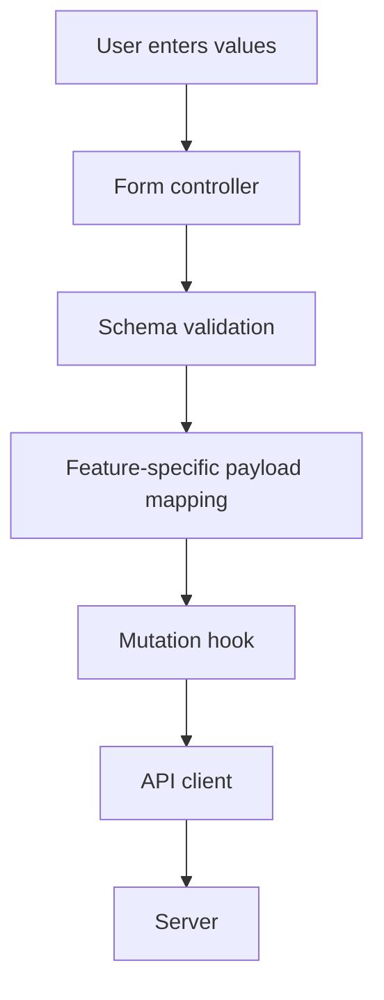

## Recommended file boundary

Instead of putting every responsibility in one file:

```text
EducationCreateForm.tsx
├── every field
├── every label
├── validation
├── error formatting
├── API call
├── loading state
├── layout
└── success behavior
```

Use focused modules:

```text
features/education/
├── EducationCreateForm.tsx       # composition and layout
├── educationFormSchema.ts        # validation and form contract
├── educationFormFields.ts        # field metadata
├── useEducationCreateForm.ts     # controller and submit workflow
└── educationPayload.ts           # form values → API payload

components/forms/
├── FormField.tsx                 # reusable field scaffold
├── FormSelect.tsx                # reusable select behavior
├── FormDateField.tsx             # reusable date behavior
├── FormError.tsx                 # reusable error presentation
└── FormActions.tsx               # reusable submit/cancel actions
```

## Schema owns validation

```tsx
import { z } from "zod";

export const educationFormSchema = z.object({
  educationType: z.string().min(1, "Education type is required."),
  institutionName: z.string().min(1, "Institution is required."),
  program: z.string().nullable(),
  startDate: z.string().nullable(),
});

export type EducationFormValues = z.infer<typeof educationFormSchema>;
```

Validation is defined once and can support the form, tests, imported data,
preview workflows, and future alternate interfaces.

## Field metadata owns scaffolding decisions

```tsx
export const educationFields = [
  {
    name: "educationType",
    label: "Education type",
    kind: "text",
    required: true,
  },
  {
    name: "institutionName",
    label: "Institution",
    kind: "text",
    required: true,
  },
  {
    name: "program",
    label: "Program",
    kind: "text",
    required: false,
  },
] as const;
```

The feature chooses which fields exist. `FormField` owns the repeated label,
input, description, error, and accessibility structure.

## The form controller owns behavior

```tsx
export function useEducationCreateForm({ onSuccess }: Options) {
  const createEducation = useCreateEducationMutation();

  const form = useForm<EducationFormValues>({
    resolver: zodResolver(educationFormSchema),
    defaultValues: {
      educationType: "",
      institutionName: "",
      program: null,
      startDate: null,
    },
  });

  const onSubmit = form.handleSubmit(async (values) => {
    await createEducation.mutateAsync(toEducationPayload(values));
    onSuccess();
  });

  return {
    ...form,
    onSubmit,
    isSubmitting: createEducation.isPending,
  };
}
```

The form view remains focused on composition:

```tsx
export function EducationCreateForm({ onSuccess }: Props) {
  const form = useEducationCreateForm({ onSuccess });

  return (
    <form onSubmit={form.onSubmit}>
      <FormSection title="Education">
        <FormField
          control={form.control}
          name="educationType"
          label="Education type"
        />

        <FormField
          control={form.control}
          name="institutionName"
          label="Institution"
        />

        <FormField
          control={form.control}
          name="program"
          label="Program"
        />
      </FormSection>

      <FormActions isSubmitting={form.isSubmitting} />
    </form>
  );
}
```

## Responsibility rule

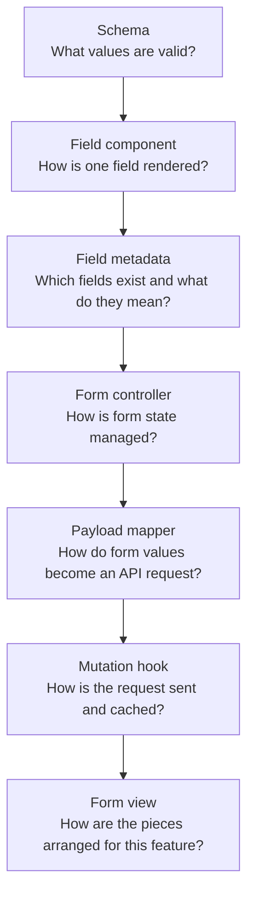

## The design principle

Forms should be composed from reusable field primitives, schema contracts,
field definitions, and workflow hooks—not rebuilt as large one-off scaffolds.

The existing Console convention already points in this direction: React Hook
Form owns form state, Zod owns validation, TanStack Query owns writes and cache
invalidation, and each feature keeps its resource-specific fields and payload
mapping explicit.

## Applied Console structure

The Console does not currently use one folder per form schema. Its actual
pattern is a centralized form family:

```text
Console/src/
├── components/forms/CreateForm.tsx
│   └── reusable frame and field scaffolds
│
└── features/create/RecordCreateForms.tsx
    ├── shared FormShell
    ├── shared Text and Select wrappers
    ├── addressSchema + AddressCreateForm
    ├── educationSchema + EducationCreateForm
    ├── employmentSchema + EmploymentCreateForm
    ├── transactionSchema + TransactionCreateForm
    ├── serviceSchema + ServiceAccountCreateForm
    └── domainSchema + DomainCreateForm
```

Feature screens consume those forms from their existing locations:

```text
EducationView
    └── features/create/RecordCreateForms.tsx
            ├── educationSchema
            ├── EducationCreateForm
            └── components/forms/CreateForm.tsx
```

This is already a valid modular pattern:

- `CreateForm.tsx` owns reusable form presentation and field scaffolding.
- `RecordCreateForms.tsx` owns the create-form family and its resource-specific
  schemas.
- Each exported `*CreateForm` owns the fields for one resource.
- The feature view owns when the form opens and what happens after creation.
- The data mutation remains with the feature or query layer that invokes it.

The earlier per-feature tree is a possible future extraction, not a requirement
and not the current Console structure. Only split `RecordCreateForms.tsx` when
the file’s size or change frequency makes the shared family harder to navigate.
If that happens, preserve the existing public form components while moving one
resource at a time:

```text
features/create/
├── RecordCreateForms.tsx        # compatibility exports during migration
├── education/
│   ├── EducationCreateForm.tsx
│   └── educationSchema.ts
└── employment/
    ├── EmploymentCreateForm.tsx
    └── employmentSchema.ts
```

The boundary should follow a real reason to change, not an idealized folder
diagram.

---

## Page 5: Data Sources, Adapters, and Query State

## The core statement

> The UI should consume a stable application-facing interface, while
> source-specific code handles API, JSON, CSV, or another backend.

This is the **data-source adapter pattern**. It lets a feature remain stable
while its source changes.

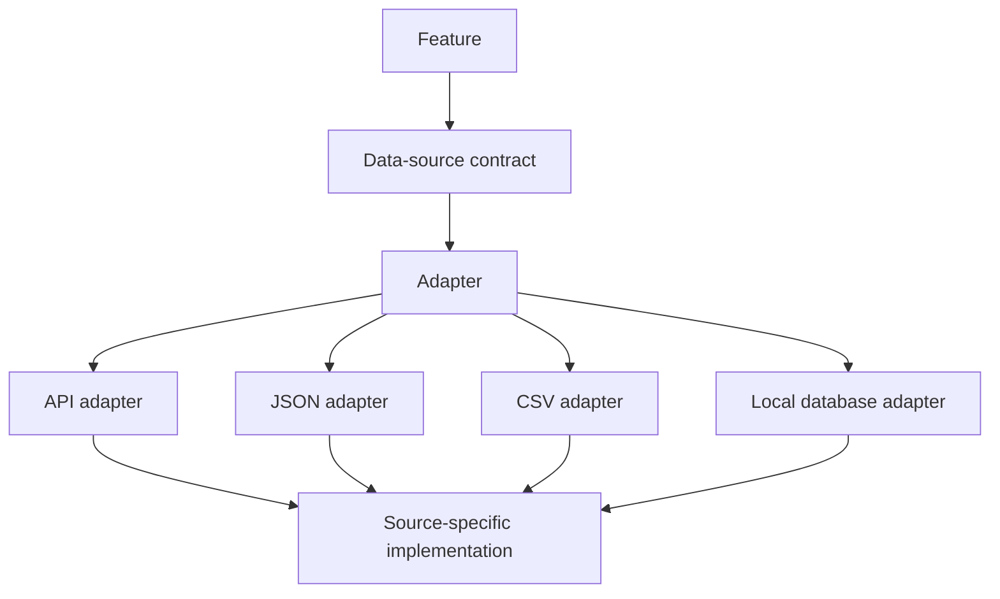

The adapter is often confusing because it resembles the API call. That
similarity is intentional: the adapter translates a source into the contract
the feature understands.

## Interface means contract

An interface is a contract. It says what a feature can ask for and what it will
receive. It does not say how the request is implemented.

```tsx
export interface EducationDataSource {
  list(signal?: AbortSignal): Promise<Education[]>;
  get(id: string, signal?: AbortSignal): Promise<Education>;
  create(
    payload: EducationCreate,
    signal?: AbortSignal,
  ): Promise<Education>;
}
```

The feature knows it can list, retrieve, and create Education records. It does
not need to know whether those records came from `/education` using `fetch`, a
JSON fixture, or a CSV import.

`EducationCreate` is separate from `Education` because a server response may
include generated fields, timestamps, relationships, or computed values that a
create form should never submit.

## Adapter versus API client

The API client describes the actual transport endpoint:

```tsx
export const api = {
  listEducation: (signal?: AbortSignal) =>
    request<Education[]>("/education", { signal }),

  createEducation: (payload: EducationCreate) =>
    request<Education>("/education", {
      method: "POST",
      body: JSON.stringify(payload),
    }),
};
```

The adapter presents that source through the feature contract:

```tsx
export const educationApiSource: EducationDataSource = {
  list: (signal) => api.listEducation(signal),
  get: (id, signal) => api.getEducation(id, signal),
  create: (payload, signal) => api.createEducation(payload, signal),
};
```

At first, an adapter may be a small pass-through. It becomes valuable when a
source needs translation, such as mapping JSON fields, parsing CSV, or
converting an external API response into application contracts.

## Query is not Redux configuration

TanStack Query and Redux solve different problems:

```text
TanStack Query
    owns server state
    ├── fetching
    ├── caching
    ├── refetching
    ├── loading and error state
    └── mutation invalidation

Redux Toolkit
    owns shared client/application state
    ├── workspace state
    ├── cross-feature selections
    ├── offline queues
    ├── durable drafts
    └── complex global workflows
```

TanStack Query does not configure Redux. Redux does not replace TanStack Query.
They may coexist, but their ownership boundaries remain separate.

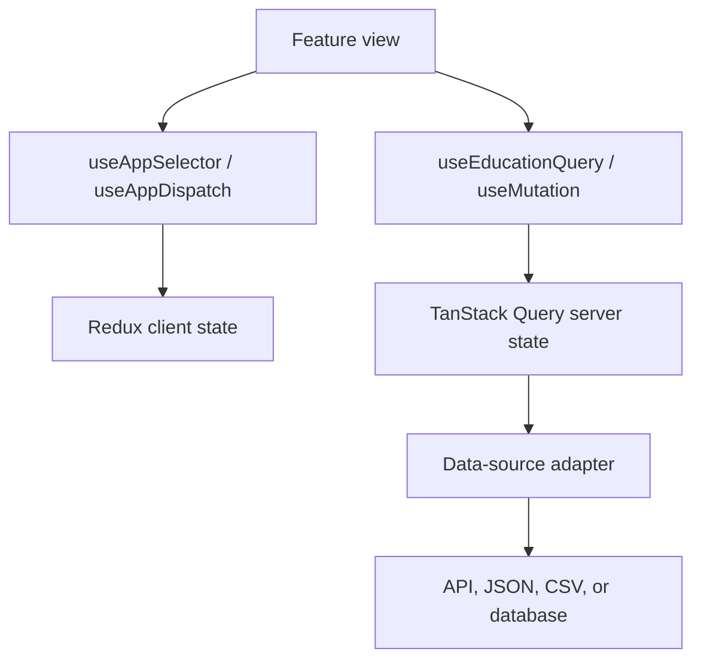

## What `useQuery` means

`useQuery` is the React-facing hook from TanStack Query. It connects a
component or feature hook to a query cache.

```tsx
export function useEducationQuery(enabled: boolean) {
  return useQuery({
    queryKey: ["education"],
    queryFn: ({ signal }) => educationApiSource.list(signal),
    enabled,
  });
}
```

The adapter owns how records are obtained. The query owns how the UI observes,
caches, refreshes, and invalidates those records.

## Finding the API contract

Use this order of evidence when writing an adapter:

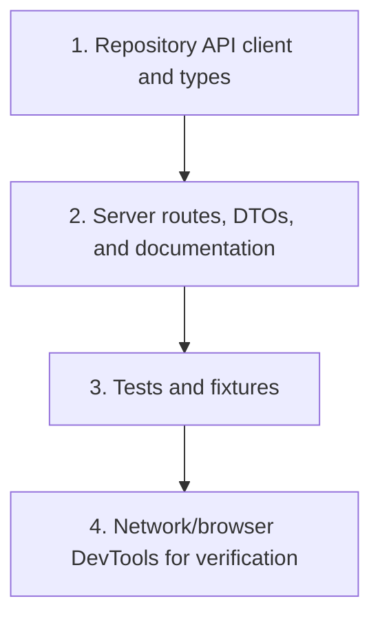

Browser DevTools can verify the request URL, HTTP method, headers, request body,
response status, response JSON, pagination parameters, cache headers, and
validation failures.

DevTools should verify a contract, not become the only source of truth. If the
repository and browser disagree, investigate the mismatch instead of copying
an observed request into the UI without understanding it.

## CSV and JSON are boundary formats

External formats should be normalized before entering the feature layer:

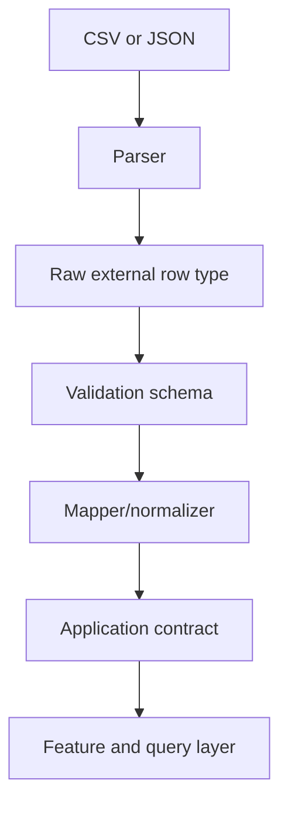

```tsx
interface EducationCSVRow {
  institutionName: string;
  educationType: string;
  program?: string;
}

function mapEducationCSVRow(row: EducationCSVRow): EducationCreate {
  return {
    id: crypto.randomUUID(),
    institutionName: row.institutionName.trim(),
    educationType: row.educationType.trim(),
    program: row.program?.trim() || null,
  };
}
```

CSV column names and formatting stay at the ingestion boundary. The rest of the
application works with `EducationCreate`, not raw CSV rows.

## Fetch or Axios?

Both are transport choices, not architecture choices:

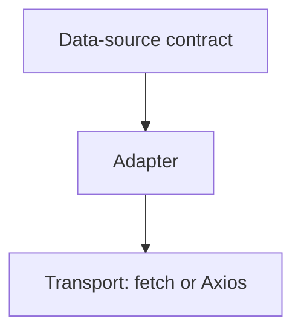

`fetch` is built into the browser and is already appropriate for the Console.
The Console’s `checkedFetch` and `request<T>` functions add authentication,
cancellation, status handling, JSON parsing, and standardized `APIError`
values.

Axios can provide defaults, interceptors, timeout configuration, and convenient
response handling. It does not remove the need for contracts, adapters, query
hooks, or response normalization.

## Practical decision rule

Start simple:

```text
api.ts + query hook
```

Introduce an explicit data-source interface and adapter when one feature needs
more than one source:

```text
EducationDataSource
├── educationApiSource
├── educationJsonSource
└── educationCsvSource
```

Keep the concerns separate:

```text
Transport
    How is the request made?

Adapter
    How is this source translated?

Data-source contract
    What operations does the feature need?

Query layer
    How is asynchronous server state observed and cached?

Redux layer
    What shared client state must the application remember?

Feature
    How is the result presented to the user?
```

---

## Page 6: Routing as the Addressable Feature Boundary

## The core idea

Routing connects a URL to a React feature. React renders components, while
React Router decides which component belongs to a path.

The applicable GemsForgeAPI Console reference currently uses
`react-router-dom` 7.x. The examples in this section use the familiar
declarative `BrowserRouter`, `Routes`, and `Route` style; keep the repository's
actual package imports and route setup authoritative when React Router changes.

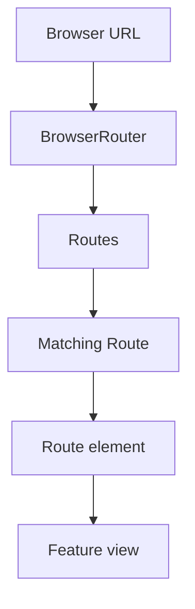

The simplest description is:

> A route is the addressable entry point to a feature.

## The routing anatomy

In a React application, the layers usually look like this:

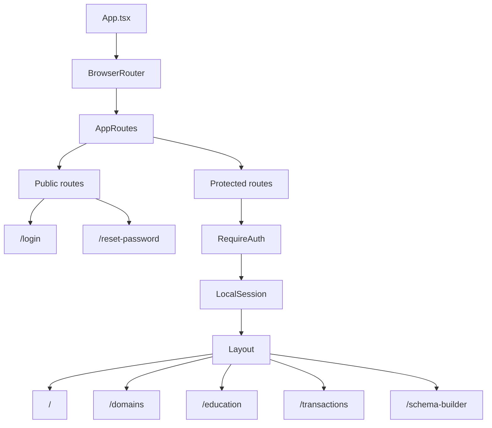

The route configuration answers:

```text
What URL activates this feature?
What access rules apply?
What layout surrounds it?
What parameters does it receive?
Which feature view should render?
```

The feature then answers:

```text
What data does it need?
What workflow does it own?
What components should it compose?
```

## Route declarations

```tsx
<Route path="education" element={<Education />} />
<Route path="transactions" element={<Transactions />} />
<Route path="schema-builder" element={<Schema />} />
```

This means:

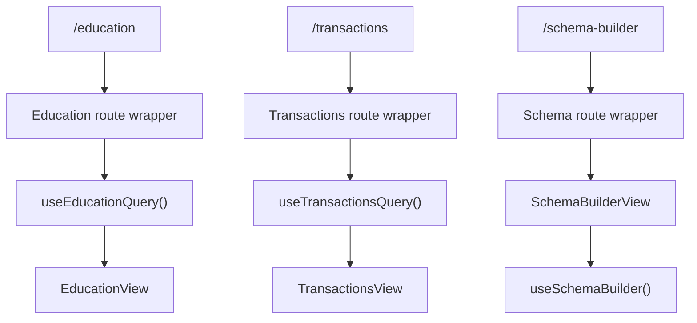

## What React Router owns

React Router owns:

- the current URL;
- browser Back and Forward behavior;
- route matching;
- path parameters;
- navigation;
- nested layouts;
- redirects;
- not-found routes; and
- route-level loading or error boundaries.

React Router does not own:

- API requests;
- server-state caching;
- form state;
- Redux state;
- feature business rules; or
- visual styling.

This separation keeps the router as the page-routing service instead of turning
it into a global application controller.

## Links and programmatic navigation

Use `Link` for visible navigation:

```tsx
<Link to="/education">Education</Link>
```

Use `useNavigate` when navigation happens because of an event or workflow:

```tsx
const navigate = useNavigate();

function openChildren(pageID: number) {
  navigate(`/forgekeeper/${pageID}/children`);
}
```

```text
Link
    declarative navigation in the rendered interface

useNavigate
    programmatic navigation after an action or workflow
```

Use router links for internal application paths rather than plain anchor tags
when a full document reload is unnecessary.

## Route parameters

This route declares a dynamic parameter:

```tsx
<Route path="domains/:domainID" element={<Pages kind="domain" />} />
```

The component reads it with `useParams`:

```tsx
function Pages() {
  const { domainID, pageID } = useParams();

  // domainID came from /domains/:domainID
  // pageID came from /forgekeeper/:pageID/children
}
```

The URL is the source of truth:

```text
/domains/POS
    domainID = "POS"

/forgekeeper/42/children
    pageID = "42"
```

Do not copy a route parameter into unrelated React state unless the application
needs a temporary editable version.

## Nested routes and `Outlet`

Nested routes allow several pages to share a layout. The parent route renders
the shell, and the `Outlet` is the location where the matching child route is
inserted.

```tsx
function Layout() {
  return (
    <GemLifeShell>
      <Notice />
      <ScreenBoundary>
        <Suspense fallback={<p>Loading screen…</p>}>
          <Outlet />
        </Suspense>
      </ScreenBoundary>
    </GemLifeShell>
  );
}
```

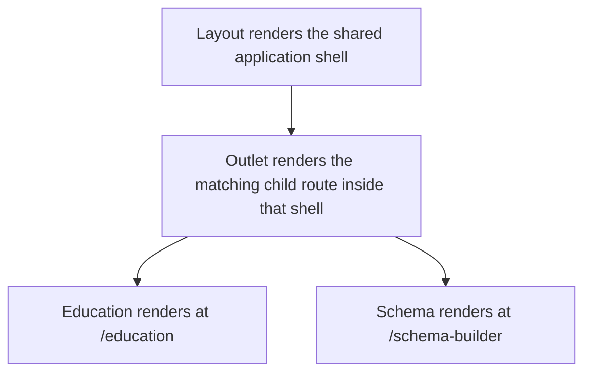

The `Outlet` does not represent a path by itself. It represents a rendering
slot for whichever nested route matched.

This gives every authenticated screen the same:

- application shell;
- sidebar;
- notification region;
- error boundary;
- lazy-loading boundary; and
- route-focus behavior.

## Routing and data loading

Routing selects the feature. Query hooks load the feature’s data.

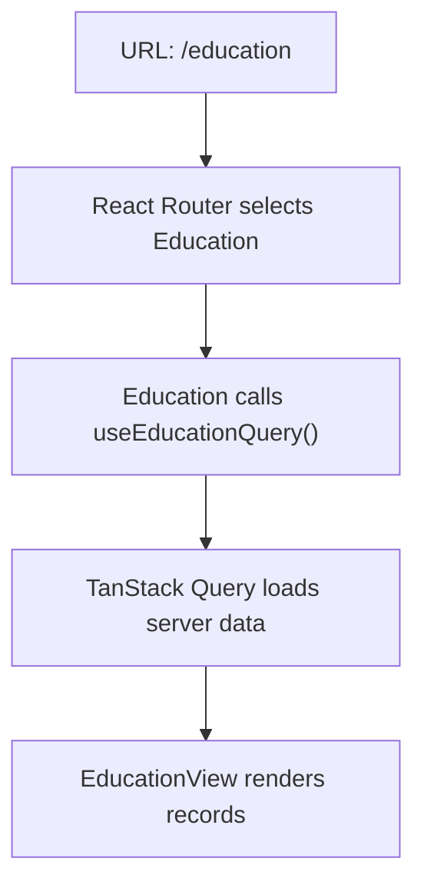

Do not make the router responsible for all data behavior. The route connects the
URL to the feature; the feature and query layers own their data.

## The applied Console pattern

```tsx
function Education() {
  const query = useEducationQuery(true);

  return (
    <QueryScreen query={query}>
      {(records) => <EducationView records={records} />}
    </QueryScreen>
  );
}
```

This route wrapper connects three boundaries:

```text
Route wrapper
    connects URL to data

Query hook
    owns asynchronous server state

Feature view
    renders and coordinates the feature
```

The routing layer is therefore an addressable composition layer, not the place
to put every feature responsibility.

---

### File Names as Role and Action Labels

## The purpose of naming

A file name should help answer two questions before the file is opened:

```text
What role does this file play?
What action or responsibility does it own?
```

The name should describe the file’s responsibility, not merely the screen where
it happens to be used.

```text
DatabaseRecordCollection.tsx
    role: shared collection view
    action: renders table structure, pagination, views, selection, and rendering

useEducationRecordActions.ts
    role: feature-owned action composer
    action: builds Education-specific create/import menu actions
```

## File-name convention map

| File-name pattern | Role | Owns | Does not own |
| --- | --- | --- | --- |
| `SomethingView.tsx` | Feature view | Feature composition and user intent | Generic primitives or raw transport |
| `SomethingPage.tsx` | Route/page composition | Addressable page composition | Reusable field or table internals |
| `SomethingLayout.tsx` | Layout | Shared visual arrangement and slots | Feature API behavior |
| `SomethingCollection.tsx` | Collection view | Repeated list/table/gallery structure | Resource-specific fetching |
| `SomethingDetail.tsx` | Detail view | One record’s feature-specific presentation | Collection pagination |
| `SomethingCard.tsx` | Card component | One reusable record/card presentation | Server requests |
| `SomethingField.tsx` | Field component | Label, input, error, and accessibility pattern | Whole-form submission |
| `SomethingForm.tsx` | Form composition | Feature form layout and field arrangement | Shared field scaffolding and transport |
| `SomethingSchema.ts` | Validation contract | Valid values and validation rules | Rendering and requests |
| `SomethingTypes.ts` | Type contract | TypeScript shapes and unions | Side effects and UI rendering |
| `SomethingPayload.ts` | Data mapper | Form/UI values to API payloads | Form state and visual layout |
| `useSomething.ts` | Custom hook | One reusable state or behavior boundary | Generic unrelated concerns |
| `useSomethingWorkflow.ts` | Workflow hook | Multi-step state transitions and commands | JSX structure |
| `useSomethingActions.ts` | Feature action composer | Feature-specific action configuration and handlers | Shared action rendering |
| `createSomethingActions.ts` | Action factory | Builds action configuration from explicit inputs | React lifecycle or hidden global state |
| `SomethingQueries.ts` | Query module | Reads, mutations, keys, and invalidation | JSX and visual styling |
| `SomethingApi.ts` | API adapter | Endpoint-specific transport calls | Query caching and feature layout |
| `SomethingAdapter.ts` | Source adapter | Maps API, JSON, CSV, or database data to a contract | Rendering and route decisions |
| `SomethingTableAdapter.ts` | Table adapter | Maps a domain record to table properties and cells | Table rendering engine behavior |
| `SomethingReducer.ts` | State transition logic | Pure workflow state transitions | Network requests and JSX |
| `Something.test.tsx` | Component/feature test | User interactions and rendered behavior | Production responsibilities |
| `Something.test.ts` | Logic/data test | Schemas, reducers, mappers, and query behavior | Browser layout assertions |
| `index.ts` | Public module boundary | Intentional exports for a module | Unrelated implementation logic |

## “Feature-owned hook” versus “factory”

These names describe related but different mechanisms.

### Feature-owned hook

Use a hook when the action composer needs React state, React Query mutations,
other hooks, or lifecycle behavior.

```tsx
const actions = useEducationRecordActions({
  addresses: addresses.data ?? [],
  onCreated: (record) => setSelectedID(record.id),
});
```

```text
useEducationRecordActions.ts
    reads hooks
    creates callbacks
    returns TableActionsProps
```

### Factory

Use a factory when action configuration can be built from explicit inputs without
calling React hooks.

```tsx
const actions = createEducationRecordActions({
  addresses,
  onCreate,
  onCreated,
});
```

```text
createEducationActions.ts
    receives dependencies
    returns configuration
    has no React lifecycle
```

The distinction is:

```text
Hook
    “I need React behavior to compose this.”

Factory
    “Give me the inputs and I will build the configuration.”
```

## Avoiding a web of files

Naming conventions should clarify boundaries, not force a file for every
function. Use this extraction rule:

```mermaid
flowchart TD
    reused{"Is the responsibility reused or independently testable?"}
    reused -- No --> local["Keep it near its consumer"]
    reused -- Yes --> react{"Does it need React state, hooks, or lifecycle?"}
    react -- Yes --> hook["useSomething.ts"]
    react -- No --> factory["createSomething.ts or Something.ts"]
```

Keep related files together when they form one cohesive feature. Extract only
when the file has a clear role, a meaningful name, and a reason to change that
is different from its current owner.

## Applied Console examples

```text
DatabaseRecordCollection.tsx
    shared collection view
    renders table structure, pagination, views, selection, and rendering

RecordUtilities.tsx
    shared utility control
    renders search, sort, filter, and result summaries

educationTableAdapter.ts
    Education-to-table mapping
    defines table properties and display values

useEducationRecordActions.ts
    feature-owned action composer
    builds Input Form, Import File, and Paste Data options

EducationView.tsx
    feature view
    coordinates records, selection, detail, and feature composition
```

The title is part of the architecture. When a file name accurately describes
its role, the folder becomes easier to scan and the next developer can predict
where a new responsibility belongs.
