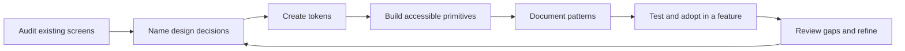

# 🎨 Centralized Design Systems

## Page 1: 🧭 What a design system does

A centralized design system gives a product one shared visual and interaction language. It helps teams make consistent decisions about color, typography, spacing, components, accessibility, and responsive behavior.

For GemLife, the design system can become the shared foundation for screens, forms, dashboards, tables, navigation, and future features. Each feature keeps its own purpose and data while using the same trusted visual building blocks.

> 💡 **Key idea:** A design system is a product capability, not only a collection of colors and buttons. It combines reusable decisions, components, documentation, and governance.

## Page 2: 🧱 The foundation: design tokens

Design tokens are named values that represent visual decisions. They prevent every component from inventing its own values.

```ts
export const tokens = {
  color: {
    background: '#f7f8f5',
    surface: '#ffffff',
    text: '#1e2823',
    mutedText: '#5f6b63',
    accent: '#355a3a',
    focus: '#c47f45',
  },
  space: {
    xs: '0.25rem',
    sm: '0.5rem',
    md: '1rem',
    lg: '1.5rem',
    xl: '2rem',
  },
  radius: {
    sm: '0.375rem',
    md: '0.75rem',
    pill: '999px',
  },
} as const;
```

Useful token groups include:

- Color roles: background, surface, text, border, accent, success, warning, and error.
- Typography: font families, sizes, weights, line heights, and letter spacing.
- Spacing: the approved gap and padding scale.
- Shape: borders, radii, and elevation.
- Motion: duration, easing, and reduced-motion behavior.
- Breakpoints: responsive layout thresholds.

Name tokens by purpose, such as `text-muted` or `surface-raised`, so a theme can change without forcing every component to know a raw color value.

## Page 3: 🧩 Components and variants

Components turn tokens into reusable interface pieces with explicit contracts.

```tsx
<GButton variant="primary" size="md">
  Save changes
</GButton>
```

### ‼️ A mature component should define
- Its semantic HTML element.
- Its typed props and supported variants.
- Its interaction states: default, hover, focus, pressed, disabled, loading, and error where relevant.
- Its accessible name, keyboard behavior, and focus treatment.
- Its responsive behavior.
- Its composition boundary and ownership of state.

Start with high-reuse components such as buttons, links, fields, headings, cards, dialogs, navigation, alerts, tables, and empty states. Add a component when it represents a repeated structure, accessibility behavior, or visual decision.

### One design-system contract, several UI libraries

**The design-system decision is the contract:** A primary action has an approved visual role, accessible name, focus state, disabled state, and spacing. The UI library supplies the implementation syntax.

***Tamagui example:***

```tsx
import { Button } from 'tamagui';

<Button theme="active" size="$4" accessibilityLabel="Save changes">
  Save changes
</Button>
```

***Bootstrap example:***

```tsx
<button type="button" className="btn btn-primary">
  Save changes
</button>
```

***Material UI example:***

```tsx
import Button from '@mui/material/Button';

<Button variant="contained" color="primary">
  Save changes
</Button>
```

The syntax changes across libraries, while the shared design decision remains stable. Record the project’s approved mapping for roles, tokens, states, semantics, and accessibility behavior. This allows GemLife to evolve its implementation library without losing its visual and interaction language.

## Page 4: 🗺️ Patterns and templates

Components solve small interface problems. Patterns combine components to solve recurring user tasks.

Examples include:

- A sign-in form with labels, validation, errors, and submit states.
- A record editor with loading, empty, success, and failure states.
- A dashboard card with a heading, metric, supporting text, and action.
- A confirmation dialog with clear consequences and keyboard-safe actions.
- A responsive page shell with navigation, content, and mobile behavior.

Document patterns when several features need the same sequence or layout. Keep feature-specific meaning in the feature layer and shared structure in the design-system layer.

## Page 5: ♿ Accessibility and responsive behavior

**Accessibility belongs in the design system from the beginning. **Treat it as a component contract rather than a final inspection step.

Check each component for:

- Semantic elements and correct heading structure.
- Keyboard reach, focus visibility, and logical focus order.
- Labels, descriptions, validation messages, and error announcements.
- Sufficient color contrast and non-color cues.
- Touch target size and readable text.
- Zoom, narrow screens, orientation, and reduced-motion behavior.
- Screen-reader names and states.

For GemLife, a component is ready for reuse when its accessibility and responsive behavior are known, documented, and tested.

## Page 6: 🔄 State and interaction contracts

Shared components need predictable states so feature teams do not redesign the same behavior repeatedly.

```mermaid
stateDiagram-v2
    [*] --> Default
    Default --> Hover
    Hover --> Focused
    Focused --> Pressed
    Pressed --> Default
    Default --> Disabled
    Default --> Loading
    Loading --> Success
    Loading --> Error
    Success --> Default
    Error --> Default
```

For each state, document what the user sees, what the component accepts, and what the user can do. Keep server state, feature workflows, and durable application state in their appropriate layers.

## Page 7: 🛠️ Tooling and documentation

A centralized system needs a way to be discovered and verified.

Useful tooling includes:

- A component library or shared UI package.
- A live component workbench such as Storybook or an equivalent preview.
- Visual regression or screenshot checks for important variants.
- Accessibility tests and keyboard checks.
- Type-safe props and token definitions.
- Linting rules that discourage raw design values in shared components.
- Generated reference pages with usage examples.

Every shared component should answer: what problem does it solve, when should it be used, which variants exist, how is it accessed, and which states must be tested?

## Page 8: 🏛️ Governance and contribution

Centralization requires an ownership process. Establish:

- Who approves new tokens and components.
- How breaking changes are communicated.
- How deprecated components are marked and removed.
- How accessibility and responsive requirements are reviewed.
- How feature teams propose additions or report gaps.
- How releases and migration notes are recorded.

Use a small decision record for significant changes. Explain the problem, the chosen approach, alternatives considered, affected components, migration steps, and verification evidence.

## Page 9: 🚀 Building the GemLife system incrementally



Begin with the screens GemLife already has. Record repeated colors, type styles, spacing, field behavior, and layout patterns. Convert the most stable decisions into tokens, then build the smallest reusable components that remove real duplication.

Avoid designing every possible component in advance. A system becomes trustworthy when its components solve current product problems and have evidence from real feature usage.

## References

- [Material Design: Design tokens](https://m3.material.io/foundations/design-tokens/overview)
- [W3C Design Tokens Community Group](https://www.designtokens.org/)
- [W3C Web Accessibility Initiative](https://www.w3.org/WAI/)
- [MDN: ARIA](https://developer.mozilla.org/en-US/docs/Web/Accessibility/ARIA)
- [Storybook: Design systems](https://storybook.js.org/tutorials/design-systems-for-developers/)
- [Figma: Design systems](https://www.figma.com/resource-library/what-is-a-design-system/)
