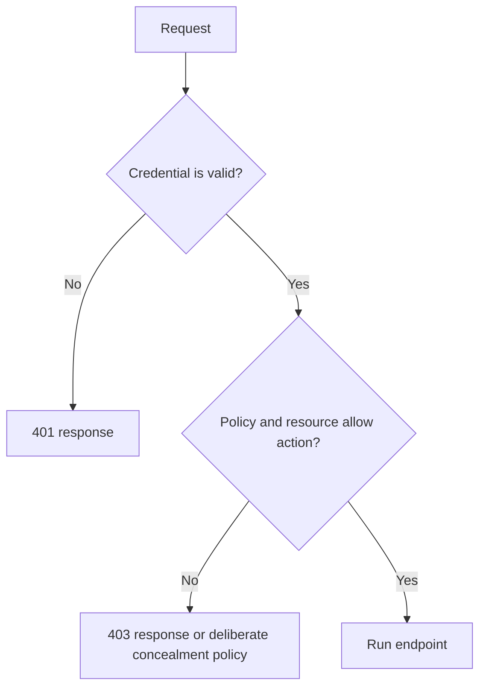

# 🔐 Authentication and Authorization in ASP.NET Core

## Page 1: 🎯 Purpose


**Category:** Software Engineering / C# / ASP.NET Core  
**Example:** Protecting employee records

### Two different questions

**Authentication** establishes who is making a request. A configured handler validates a credential such as a bearer token or cookie. **Authorization** decides whether that identity may perform an action on a resource.

A valid login does not automatically grant access to every employee record. An endpoint policy may require a permission, and a resource rule may further restrict access to records within the caller's organization.




## Page 2: 🪪 Configuring identity and policy

### Register the authentication handler

Configure a handler that matches the identity provider and token format. This example illustrates JWT bearer setup; real authority and audience values come from environment configuration.

```csharp
builder.Services
    .AddAuthentication(JwtBearerDefaults.AuthenticationScheme)
    .AddJwtBearer(options =>
    {
        options.Authority = builder.Configuration["Authentication:Authority"];
        options.Audience = builder.Configuration["Authentication:Audience"];
    });

builder.Services.AddAuthorization(options =>
{
    options.AddPolicy("EmployeeReader", policy =>
        policy.RequireAuthenticatedUser()
              .RequireClaim("permission", "employees.read"));
});
```

A production handler must validate the token's signature, issuer, audience, and lifetime. Decoding a token without validating it does not authenticate its claims.


## Page 3: 🛡️ Applying authorization

### Require permission at the boundary

```csharp
[Authorize(Policy = "EmployeeReader")]
[HttpGet("{id:int}")]
public async Task<ActionResult<EmployeeResponse>> GetById(
    int id,
    CancellationToken cancellationToken)
{
    var employee = await _employees.GetByIdAsync(id, cancellationToken);
    if (employee is null)
    {
        return NotFound();
    }

    return Ok(new EmployeeResponse(employee.Id, employee.Name, employee.Department));
}
```

The policy checks a permission shared by an operation. A resource-based authorization check can then ask whether this particular caller may see this particular employee. Do not rely on an unguessable ID as an access control mechanism.


## Page 4: 🚦 Reading access outcomes

### Understand denial responses

- `401 Unauthorized`: credentials are missing, expired, invalid, or otherwise unacceptable; the client needs valid authentication.
- `403 Forbidden`: the caller is authenticated but is not allowed to perform the requested action.
- `404 Not Found`: the resource is absent, or the service deliberately conceals its existence from an unauthorized caller. If using concealment, apply it consistently so it does not become an information leak.

See [HTTP status codes](aspnet-core-http-status-codes.md) for broader response selection.


## Page 5: 🧪 Security verification

### Security checks to test

Verify missing credentials, invalid or expired credentials, a caller with permission, a caller without permission, and attempts to access another user's record. Check that responses and logs do not reveal tokens or internal authorization details.

### References

- [ASP.NET Core authentication](https://learn.microsoft.com/aspnet/core/security/authentication/)
- [ASP.NET Core authorization](https://learn.microsoft.com/aspnet/core/security/authorization/introduction)
- [HTTP status codes](aspnet-core-http-status-codes.md)
- [Testing and interfaces](aspnet-core-testing-and-interfaces.md)
