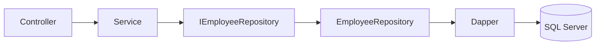

# 🗃️ Dapper and the Repository Pattern in ASP.NET Core

## Page 1: 🎯 Purpose


**Category:** Software Engineering / C# / ASP.NET Core  
**Example:** Looking up an employee by ID

### Dapper and repositories

Dapper is a lightweight .NET data access library. It executes SQL and maps returned columns to .NET objects. A repository groups persistence operations behind an application-facing contract, keeping SQL and database mapping out of controllers and business workflows.




## Page 2: 🧩 The repository contract

### Define a useful boundary

```csharp
public interface IEmployeeRepository
{
    Task<EmployeeRecord?> GetByIdAsync(int id, CancellationToken cancellationToken);
}
```

The interface is useful because the service depends on a persistence capability and can be tested with a controlled substitute. It should describe operations the application needs, not mirror every Dapper method.


## Page 3: 🔎 Safe Dapper query

### Implement a parameterized query

```csharp
public sealed class EmployeeRepository : IEmployeeRepository
{
    private readonly string _connectionString;

    public EmployeeRepository(IConfiguration configuration)
    {
        _connectionString = configuration.GetConnectionString("Employees")
            ?? throw new InvalidOperationException("Employees connection string is missing.");
    }

    public async Task<EmployeeRecord?> GetByIdAsync(
        int id,
        CancellationToken cancellationToken)
    {
        await using var connection = new SqlConnection(_connectionString);
        const string sql = "SELECT Id, Name, Department FROM Employees WHERE Id = @Id";
        var command = new CommandDefinition(
            sql, new { Id = id }, cancellationToken: cancellationToken);
        return await connection.QuerySingleOrDefaultAsync<EmployeeRecord>(command);
    }
}
```

Dapper binds `@Id` as a parameter. Keep values separate from SQL; never interpolate raw caller input into query text. Passing cancellation lets the operation stop when the request is abandoned, subject to provider support.


## Page 4: 📥 Reading query outcomes

### Understand the result

`QuerySingleOrDefaultAsync<T>` returns the mapped row when one exists, or the default value (`null` for a reference type) when there is no row. A database error faults the operation and surfaces as an exception when awaited. Those are different outcomes: absence is a successful lookup result, while an exception means the operation failed.

Repositories can own connection creation and query mapping. Avoid making a repository swallow infrastructure errors and turn them into `null`, because callers could incorrectly report `404`. The [backend handbook's error and failure behavior section](backend-api-microservices-engineering-handbook.md#page-6--errors-failure-behavior-and-observability) discusses centralized handling and safe client responses.


## Page 5: 🔄 Coordinating persistence work

### Transactions and scope

If one use case must make several related writes atomically, coordinate the transaction deliberately. The application service often knows the use-case boundary; a persistence abstraction can expose a unit-of-work or transaction capability when the design needs one. Do not add a generic repository framework automatically for a small set of Dapper queries.

### When an interface helps

An interface is valuable when it represents a real substitution or ownership boundary: service versus database, provider-specific implementation, or a test seam for service behavior. It is not a goal by itself. Repository SQL and mapping still need integration tests against a compatible database because mocks cannot verify SQL syntax or schema behavior.

### References

- [Dapper project and documentation](https://github.com/DapperLib/Dapper)
- [Database testing handbook](../data/database-testing-handbook.md)
- [Layered architecture](aspnet-core-layered-architecture.md)
- [Testing and interfaces](aspnet-core-testing-and-interfaces.md)
