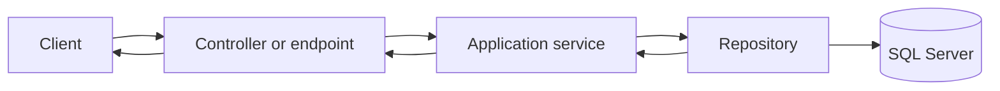

# 🧱 Layered Architecture in an ASP.NET Core API

## Page 1: 🎯 Purpose


**Category:** Software Engineering / C# / ASP.NET Core  
**Example:** Employee API with Dapper

### What layered architecture means

Layered architecture assigns related responsibilities to distinct parts of an application. A web request enters through an API endpoint, the application applies its use case and rules, and a persistence component reads or writes data. The separation lets each part change for reasons related to its own responsibility.




## Page 2: 🗺️ Responsibilities and boundaries

### The main boundaries

| Part | Owns | Example |
|---|---|---|
| Endpoint/controller | HTTP binding, authentication metadata, response status and body | `EmployeesController` |
| Request/response contract | Public input and output shape | `CreateEmployeeRequest`, `EmployeeResponse` |
| Application service | A use case and its business decisions | `EmployeeService.GetByIdAsync` |
| Repository | SQL, persistence operations, and row mapping | `EmployeeRepository` with Dapper |
| Database | Durable records and integrity rules | `Employees` table |

A controller should not compose SQL or encode business workflows. A repository should not choose HTTP status codes. The service should not need to know whether an HTTP request arrived or whether the caller expects JSON.


## Page 3: 🔁 Follow an Employee request

### Trace one request

For `GET /api/employees/42`, the endpoint parses the route parameter and calls the service. The service asks the repository for employee 42. The repository executes a parameterized query and returns an employee or `null`. The service applies any relevant business policy. The endpoint maps a found employee to `200 OK`, or a missing one to `404 Not Found`.

Each call has a clear direction: an outer layer depends on a contract offered by an inner responsibility. Constructor injection supplies these dependencies; see [dependency injection and service lifetimes](aspnet-core-dependency-injection-and-lifetimes.md).


## Page 4: 🧭 Choosing useful boundaries

### Keep the design proportional

Layering is a way to make responsibilities visible, not a requirement to create a project or interface for every class. A small API may keep these types in one project and use a few folders. Add a boundary when it provides a useful distinction, test seam, or change boundary. Avoid pass-through classes that add no policy, orchestration, or isolation.

A practical layout might be:

```text
Api/
├── Controllers/EmployeesController.cs
├── Contracts/Employees/CreateEmployeeRequest.cs
├── Contracts/Employees/EmployeeResponse.cs
├── Services/EmployeeService.cs
├── Repositories/EmployeeRepository.cs
├── Models/Employee.cs
└── Program.cs
```

### When a layer is useful

- Put a rule in the service when it describes what the application is allowed to do, regardless of transport.
- Put query construction and database mapping in the repository.
- Put serialization and HTTP response choices at the endpoint boundary.
- Keep request and response types aligned to the API contract, not automatically to table columns.

### References

- [Backend API and microservices engineering handbook](backend-api-microservices-engineering-handbook.md)
- [Dependency injection and service lifetimes](aspnet-core-dependency-injection-and-lifetimes.md)
- [Dapper and the repository pattern](aspnet-core-dapper-repository-pattern.md)
- [ASP.NET Core Web API overview](https://learn.microsoft.com/aspnet/core/web-api/)
