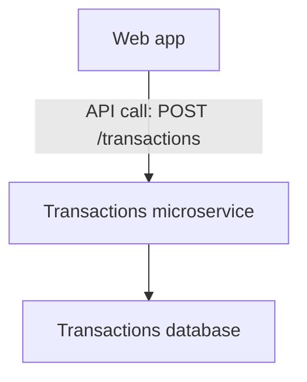
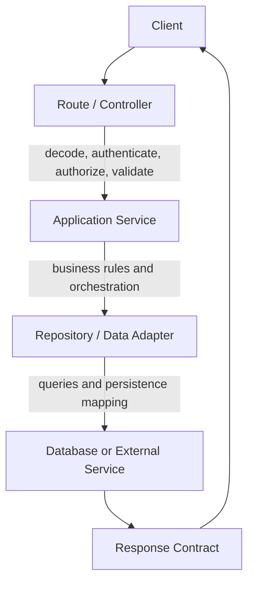
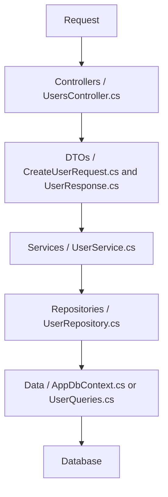
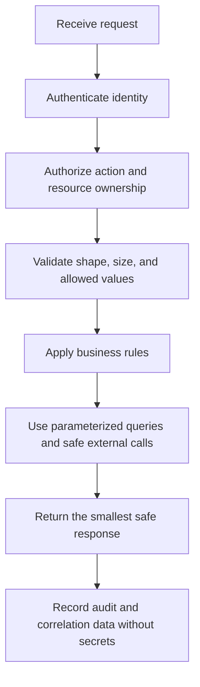
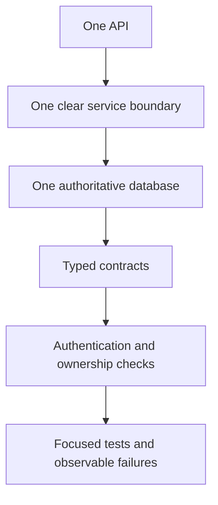

# 🔌 Backend API and Microservices Engineering Handbook

## Page 1: 🎯 Purpose

This handbook is a practical reference for designing and building backend APIs and services across Swift/Vapor, C#/.NET, TypeScript, and other languages.

It focuses on the engineering work before deployment: boundaries, contracts, data flow, security, failure behavior, testing, and documentation.

> 🧬 Guiding principle: Keep transport, business rules, persistence, and contracts separate enough that each can change without forcing the entire system to change.

**📥 Request → 🔐 Authenticate → 🧾 Validate → 🧠 Apply rules → 💾 Persist → 📤 Respond → 🔎 Observe**

### 👋 Introduction: API and microservice are not the same thing

An **API** is an interface. It defines how software communicates through requests, responses, authentication, status codes, and errors.

A **microservice** is an independently owned backend component. It organizes code, business responsibility, data access, and service behavior around a focused capability.

| Concept | Meaning |
|---|---|
| API | A communication boundary: endpoints, requests, responses, authentication, and errors. |
| Microservice | An ownership and execution boundary: a focused backend component with its own responsibility, code, data boundary, and lifecycle. |



In this example, `POST /transactions` is the API. The Transactions microservice is the backend component that validates the request, applies transaction rules, saves the record, and returns the response.

Important distinctions:

- A monolithic backend can expose many APIs.
- A microservice usually exposes one or more APIs.
- An API does not require microservices.
- Microservices can communicate through APIs, events, or queues.
- Splitting one backend into microservices does not automatically improve the system; each service adds coordination, testing, security, and operational complexity.

> 🧭 API = communication boundary. Microservice = ownership and execution boundary.

### 🧭 Scope boundary

This book covers API and service engineering. Deployment, hosting, containers, CI/CD, production release operations, and infrastructure are intentionally reserved for a separate Deployment and Operations Handbook.

## Page 2: 🗺️ Request flow and core layers



### 🧱 Core layers

| Layer | ✅ What this layer should do | ❌ Keep this layer from doing |
|---|---|---|
| API route or controller | Receive the request, authenticate the caller, validate the request shape, call the service, and return the correct HTTP response. | Business decisions, long SQL queries, or direct table manipulation. |
| Contract or DTO | Define what the API accepts and returns, including field names, required values, public compatibility, and safe response data. | Reading from the database or deciding how records are stored. |
| Application service | Execute one business use case, coordinate repositories or other services, enforce business rules, and decide transaction boundaries. | Formatting HTTP responses or constructing database-specific queries. |
| Repository | Load and save data, write queries, map database results, and isolate database-specific behavior. | Deciding what the user is allowed to do or shaping an HTTP response. |
| Domain model | Represent business meaning, relationships, and invariants such as “an archived account cannot create a new transaction.” | Becoming an accidental transport model or exposing persistence details by default. |
| Configuration | Read environment-specific settings, validate required configuration, and provide safe defaults. | Hiding business rules in magic values or silently choosing a production resource. |
| Middleware | Apply behavior needed across many requests, such as correlation IDs, structured logging, rate limits, and exception translation. | Making decisions that only one feature understands. |

## Page 3: 🔁 Backend principles across languages and .NET

The names change between ecosystems, but the responsibility boundaries should remain recognizable.

| Responsibility | Swift/Vapor | C#/.NET | TypeScript/Node |
|---|---|---|---|
| Transport | Route handler or controller | Controller or minimal API endpoint | Route handler or controller |
| Contract | Codable request/response type | Request model, DTO, record | Type/interface plus runtime schema |
| Business rules | Service | Application service | Service or use-case module |
| Persistence | Fluent model/repository | EF Core, Dapper, or repository | Query module, ORM, or repository |
| Cross-cutting behavior | Middleware | Middleware or filters | Middleware or hooks |
| Validation | Decoding and validator | Data annotations or FluentValidation | Zod, Yup, Valibot, or equivalent |
| Tests | XCTest | xUnit, NUnit, or MSTest | Vitest, Jest, or Node test runner |

The architecture is portable even when the framework vocabulary is not.

### 🧭 .NET folder and file flow



#### Example .NET project layout

```text
src/Api/
├── Controllers/
│   └── UsersController.cs
├── Contracts/
│   └── Users/
│       ├── CreateUserRequest.cs
│       └── UserResponse.cs
├── Domain/
│   └── User.cs
├── Models/
│   └── UserRecord.cs
├── Queries/
│   └── UserQuery.cs
├── Services/
│   └── UserService.cs
├── Repositories/
│   ├── IUserRepository.cs
│   └── UserRepository.cs
├── Data/
│   ├── AppDbContext.cs
│   └── Migrations/
├── Configuration/
│   └── DatabaseOptions.cs
├── Middleware/
│   ├── CorrelationIdMiddleware.cs
│   └── ExceptionHandlingMiddleware.cs
├── Program.cs
└── Tests/
    ├── UserServiceTests.cs
    ├── UserRepositoryTests.cs
    └── UsersApiTests.cs
```

## Page 4: 🧾 Contracts, documentation, and reuse

These terms are related but not interchangeable.

| Term | Meaning | Example |
|---|---|---|
| Database schema | Tables, columns, types, constraints, indexes, and relationships | `Users.Email NOT NULL UNIQUE` |
| Domain model | The business representation of an entity | `User` with account rules |
| Persistence model | The shape used to map a stored record or database row | `UserRecord` or an EF Core entity |
| Query model | A read-focused shape designed for one query or screen, often joining or projecting several stored records | `UserSummaryQuery` with display name, account status, and transaction count |
| Request DTO | The fields a caller may submit | `CreateUserRequest` |
| Response DTO | The fields the API chooses to return | `UserResponse` |
| Runtime schema | Executable validation of untrusted input | `CreateUserSchema.parse(body)` |
| API contract | The stable agreement between client and service | `POST /users` request and response |

```csharp
public sealed record CreateUserRequest(
    string Email,
    string DisplayName
);

public sealed record UserResponse(
    Guid Id,
    string Email,
    string DisplayName,
    DateTimeOffset CreatedAt
);
```

Do not expose persistence models directly when the API contract has different privacy, naming, or lifecycle requirements.

### 📝 Code and comment documentation

Document decisions and contracts, not obvious syntax.

```csharp
/// <summary>
/// Creates an account for the authenticated owner.
/// </summary>
/// <remarks>
/// Email uniqueness is enforced by the database. The service translates
/// that constraint into a stable conflict response.
/// </remarks>
public Task<UserResponse> CreateAsync(
    CreateUserRequest request,
    UserId actor,
    CancellationToken cancellationToken);
```

Useful documentation explains:

- why a boundary exists;
- which actor may call it;
- what the request and response mean;
- which errors and side effects are possible;
- what must remain compatible; and
- which migration, relationship, or privacy rule is non-obvious.

Avoid comments that merely repeat the code. Update comments when the contract changes.

### ♻️ DRY without hiding responsibility

DRY means maintaining one source of truth for knowledge that must stay consistent. It does not mean forcing unrelated workflows into one abstraction.

#### Good reuse

```csharp
// Shared rule: every owner-scoped query applies the actor boundary.
public IQueryable<T> ForOwner<T>(IQueryable<T> query, UserId actor)
    where T : IOwnedRecord
    => query.Where(record => record.OwnerId == actor.Value);
```

#### False reuse

```csharp
// Avoid a universal service with dozens of flags and unrelated branches.
UpdateAnything(record, mode: "user-or-invoice-or-attachment", validate: true);
```

Prefer focused shared libraries, policies, validators, query helpers, and adapters. Keep feature meaning in the feature service.

## Page 5: 🔐 API security and request protection

Security is a request lifecycle, not one middleware switch.



Minimum practices:

- never trust client-supplied owner or account identifiers;
- authorize the actor before reading or changing owner-scoped data;
- validate input at the API boundary and again where business invariants require it;
- use parameterized queries and safe query builders;
- keep secrets out of source, logs, URLs, and browser storage;
- apply request size, rate, and timeout limits where appropriate;
- avoid returning stack traces, tokens, passwords, or unnecessary personal data;
- use cancellation so abandoned requests do not continue indefinitely; and
- test unauthenticated, unauthorized, cross-owner, malformed, and over-sized requests.

#### 🔎 Minimum practices explained

| Practice | Plain-language meaning | Example |
|---|---|---|
| Authenticate | Confirm who is making the request before protected work begins. | Validate a session cookie, access token, or signed service credential. |
| Authorize | Confirm that the authenticated actor may perform this action on this record. | User A must not read User B’s transactions just because User A knows the record ID. |
| Validate input | Reject missing, malformed, oversized, or unsupported values at the boundary. | Reject an empty email, an unknown status, or a file larger than the allowed limit. |
| Enforce ownership | Apply the actor or account filter in the backend query, not only in the UI. | `WHERE OwnerID = currentActorID` belongs in the protected data path. |
| Use parameterized queries | Pass values as parameters instead of joining user text into SQL. | A search for `O'Reilly` must remain data, not become executable SQL. |
| Protect secrets | Keep passwords, tokens, connection strings, and signing keys out of source and logs. | Read them from environment configuration or an approved secret store. |
| Encrypt transport | Protect credentials and personal data while moving between client and API. | Use HTTPS/TLS for remote API calls; do not send tokens over plain HTTP. |
| Handle passwords correctly | Never store a password directly. Store a slow, salted password hash and use a trusted password-hashing library. | BCrypt, Argon2, or an approved platform equivalent—not plain SHA-256. |
| Protect sessions and tokens | Give credentials an expiration, a revocation strategy, and safe storage rules. | Prefer secure, HttpOnly, SameSite cookies where the application model supports them. |
| Limit requests | Prevent one caller or payload from consuming unlimited resources. | Apply body-size limits, rate limits, query limits, and timeouts. |
| Avoid information leaks | Return only what a caller needs and never expose internals. | Return a safe error code instead of a stack trace or SQL message. |
| Log safely | Record enough to investigate without recording secrets or unnecessary personal data. | Log a correlation ID, actor ID where appropriate, operation, result, and duration. |
| Test denial paths | Prove that unsafe or unauthorized requests fail correctly. | Test missing identity, wrong owner, malformed input, replay, and oversized payloads. |

#### 🧩 Additional security basics

- Configure CORS deliberately. Allow only the origins, methods, and headers the application needs.
- Consider CSRF protection when browser cookies authenticate requests.
- Set appropriate security headers at the API or hosting boundary.
- Rotate secrets and signing keys using a documented procedure; do not wait for a leak.
- Review dependencies for known vulnerabilities and remove unused packages.
- Record security-relevant audit events such as sign-in, password reset, ownership changes, exports, and destructive actions.
- Make authentication failure, authorization failure, validation failure, conflict, not found, and rate-limit responses distinguishable without revealing sensitive details.
- Define account recovery and session-revocation behavior before calling authentication complete.

## Page 6: 🧯 Errors, failure behavior, and observability

This is primarily a **backend responsibility**. The API should define and return a stable structured error contract. Clients should parse that contract, preserve useful field-level details, show an understandable message, and avoid replacing it with unrelated frontend-only error shapes.

The backend owns the error code, safe public message, field errors, HTTP status, and correlation identifier. The client owns presentation, recovery controls, and accessible feedback.

```json
{
  "error": {
    "code": "validation_failed",
    "message": "One or more fields are invalid.",
    "fields": {
      "email": "Enter a valid email address."
    },
    "correlationId": "req-123"
  }
}
```

Distinguish authentication failure, authorization failure, validation failure, conflict, not found, dependency failure, and unexpected server failure. Preserve the original cause in internal logs while returning safe public detail.

#### 🔎 What `ProblemDetails` means

`ProblemDetails` is a standard JSON shape for explaining an HTTP failure. It
gives clients predictable fields such as a status, title, detail, and optional
instance or validation information. ASP.NET Core can produce this format as
`application/problem+json`.

For a new ASP.NET Core API, prefer the framework's `ProblemDetails` support unless
the application already has an approved error contract. A custom shape such as
the `{ "error": { ... } }` example above is also possible, but document its
mapping to HTTP status codes and keep it consistent across endpoints. The client
should display the safe message and field details; it should not invent a second
error format.

### 🔎 Observability before deployment

Deployment is a separate handbook, but service code should still make behavior diagnosable.

- use structured logs with event names and correlation IDs;
- record latency and outcome for important operations;
- expose safe health and readiness information;
- measure dependency failures, retries, and timeout counts;
- never log secrets or unnecessary personal data; and
- make failures traceable from request to service to repository.

### 🧪 Testing and MVP delivery

Test behavior at the responsibility boundary.

| Test | Proves |
|---|---|
| Contract test | Request and response shapes remain compatible |
| Service test | Business rules work without HTTP or database trivia |
| Repository test | Queries and mappings work against the intended database |
| Integration test | Route, authentication, service, repository, and database cooperate |
| Security test | Invalid identity, ownership, and input are rejected |
| Migration test | Schema changes apply safely and preserve relationships |
| Resilience test | Timeout, cancellation, conflict, and dependency failure are handled |

### 🚦 MVP path

Start with one well-bounded service before splitting into many microservices.



An MVP is sufficient when one service has a clear owner, documented endpoints, explicit contracts, safe persistence, meaningful tests, and known failure behavior. Microservices are justified by independent ownership, scaling, release, or isolation needs—not by folder count.

### 📚 Glossary and references

- **API:** An explicit interface through which software requests data or behavior.
- **DTO:** A data-transfer object used at a contract boundary.
- **Idempotency:** Repeating a safe operation produces the same effective result.
- **Microservice:** An independently owned service boundary with a focused business capability.
- **Middleware:** Cross-cutting request processing that runs around route behavior.
- **Repository:** A persistence adapter that hides query and storage details from services.
- **Service:** A use-case boundary that owns business rules and orchestration.
- **Schema:** The agreed shape and constraints of data.
- **Structured error:** A stable error object with a code, safe message, and optional field details.
- **Transport layer:** HTTP, messaging, or another mechanism that carries a request.
- **Contract test:** A test that proves an agreed request or response shape remains valid.
- **Correlation ID:** An identifier used to connect logs and events for one request.

### 🔗 Technical references

Use the official documentation for implementation details and version-specific behavior. This handbook defines the engineering boundaries; these resources define the tools.

#### Languages and backend frameworks

- [Swift documentation](https://www.swift.org/documentation/) — language and standard-library reference.
- [Vapor documentation](https://docs.vapor.codes/) — Swift web framework, routing, middleware, authentication, and testing.
- [Fluent documentation](https://docs.vapor.codes/fluent/overview/) — Vapor’s ORM and migration layer.
- [C# documentation](https://learn.microsoft.com/dotnet/csharp/) — language reference and programming guides.
- [ASP.NET Core documentation](https://learn.microsoft.com/aspnet/core/) — APIs, controllers, middleware, authentication, and configuration.
- [ASP.NET Core ProblemDetails and OpenAPI metadata](https://learn.microsoft.com/aspnet/core/fundamentals/openapi/include-metadata) — documenting structured 4xx and 5xx responses.
- [Entity Framework Core documentation](https://learn.microsoft.com/ef/core/) — relational data access, migrations, and tracking.
- [Dapper documentation](https://github.com/DapperLib/Dapper) — lightweight .NET data access.
- [Node.js documentation](https://nodejs.org/docs/latest/api/) — runtime APIs and built-in test tooling.
- [TypeScript documentation](https://www.typescriptlang.org/docs/) — language, compiler, and type-system reference.

#### Contracts and validation

- [OpenAPI specification](https://spec.openapis.org/oas/latest.html) — machine-readable HTTP API contracts.
- [Swagger documentation](https://swagger.io/docs/) — OpenAPI tooling and interactive API documentation.
- [Zod documentation](https://zod.dev/) — TypeScript-first runtime validation.
- [Yup documentation](https://github.com/jquense/yup) — JavaScript schema validation.
- [Valibot documentation](https://valibot.dev/) — modular TypeScript validation.
- [FluentValidation documentation](https://docs.fluentvalidation.net/) — .NET validation rules.

#### Security references

- [OWASP API Security Top 10](https://owasp.org/API-Security/) — common API security risks and mitigations.
- [OWASP Cheat Sheet Series](https://cheatsheetseries.owasp.org/) — practical guidance for authentication, authorization, sessions, secrets, and input handling.
- [OAuth 2.0](https://oauth.net/2/) — authorization framework reference.
- [OpenID Connect](https://openid.net/developers/how-connect-works/) — identity layer commonly used with OAuth 2.0.

#### Testing references

- [XCTest documentation](https://developer.apple.com/documentation/xctest) — Swift testing framework.
- [xUnit.net documentation](https://xunit.net/) — .NET testing framework.
- [NUnit documentation](https://docs.nunit.org/) — .NET testing framework.
- [MSTest documentation](https://learn.microsoft.com/dotnet/core/testing/unit-testing-with-mstest) — Microsoft’s .NET testing framework.
- [Vitest documentation](https://vitest.dev/) — Vite-native JavaScript and TypeScript testing.
- [Jest documentation](https://jestjs.io/docs/getting-started) — JavaScript testing framework.

### 📖 Supportive references

These resources help explain the principles behind the patterns in this handbook.

- [Microsoft REST API Guidelines](https://github.com/microsoft/api-guidelines) — practical guidance for naming, resources, errors, pagination, and compatibility.
- [Google API Design Guide](https://cloud.google.com/apis/design) — resource-oriented API design and consistency rules.
- [RFC 9457 Problem Details for HTTP APIs](https://www.rfc-editor.org/rfc/rfc9457) — standard structure for machine-readable HTTP errors.
- [Martin Fowler: Microservices](https://martinfowler.com/articles/microservices.html) — benefits, costs, boundaries, and organizational consequences of microservices.
- [Martin Fowler: Monolith First](https://martinfowler.com/bliki/MonolithFirst.html) — why a well-structured modular monolith can be a responsible MVP path.
- [Martin Fowler: Bounded Context](https://martinfowler.com/bliki/BoundedContext.html) — a useful way to think about service and domain boundaries.
- [Microsoft Architecture Center](https://learn.microsoft.com/azure/architecture/) — architecture patterns, tradeoffs, and reference designs.
- [The Twelve-Factor App](https://12factor.net/) — configuration and service design principles; deployment topics are reserved for the separate operations handbook.
- [MDN HTTP overview](https://developer.mozilla.org/docs/Web/HTTP/Overview) — accessible reference for requests, responses, methods, headers, and status codes.
- [MDN HTTP status codes](https://developer.mozilla.org/docs/Web/HTTP/Status) — practical status-code reference for API responses.
