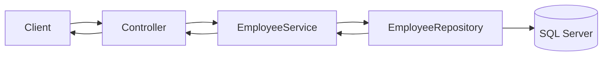

# Building an ASP.NET Core Employee API: Architecture, Dependency Injection, and Configuration

**Category:** Software Engineering / C# / ASP.NET Core  
**Topics:** Layered architecture, dependency injection, service lifetimes, `Program.cs`, configuration, Dapper  
**Example:** An Employee API backed by SQL Server

## Overview

An ASP.NET Core API is easier to change when each part has a clear responsibility. An endpoint handles HTTP; an application service coordinates a use case; a repository owns database access; and DTOs define the public request and response shapes. Dependency injection (DI) connects these pieces while keeping their construction and lifetime in one place.



## 1. The layers and their boundaries

| Part | Responsibility | Employee example |
|---|---|---|
| Controller / endpoint | Interpret HTTP input, invoke a use case, select an HTTP response | `EmployeesController.GetById` |
| Request/response DTO | Define public API input and output | `CreateEmployeeRequest`, `EmployeeResponse` |
| Service | Apply business rules and coordinate work | `EmployeeService` |
| Repository | Execute queries and map stored data | `EmployeeRepository` using Dapper |
| Database | Persist records and enforce storage constraints | `Employees` table |

A small API may use fewer projects or folders. The goal is responsibility clarity, not a prescribed number of layers. Do not place SQL in controllers or HTTP status selection in repositories. Keep transport DTOs distinct from database rows when their fields or change rates differ.

## 2. Dependency injection in ASP.NET Core

DI means a class receives the collaborators it needs, commonly through its constructor. ASP.NET Core's built-in service container creates registered services and supplies them when constructing controllers and other services.

```csharp
public sealed class EmployeeService : IEmployeeService
{
    private readonly IEmployeeRepository _employees;

    public EmployeeService(IEmployeeRepository employees)
    {
        _employees = employees;
    }

    public Task<Employee?> GetByIdAsync(int id, CancellationToken cancellationToken) =>
        _employees.GetByIdAsync(id, cancellationToken);
}
```

Register the interface-to-implementation mapping at startup:

```csharp
builder.Services.AddScoped<IEmployeeRepository, EmployeeRepository>();
builder.Services.AddScoped<IEmployeeService, EmployeeService>();
```

Constructor injection makes dependencies visible, supports focused unit tests, and avoids classes locating hidden global services.

### Choosing a lifetime

| Lifetime | Instance behavior | Typical use |
|---|---|---|
| Transient | A new instance is created each time it is requested | Small stateless services |
| Scoped | One instance per web request scope | Request-oriented services and repositories |
| Singleton | One instance for the application's lifetime | Thread-safe shared services and immutable caches |

A scoped repository is a common default when its dependencies are scoped or request-bound. A singleton must be safe for concurrent use and must not capture scoped services. Capturing a scoped dependency in a singleton can cause incorrect cross-request reuse or a lifetime validation error. Creating a scope deliberately is a separate pattern and should be limited to hosted/background work that needs scoped services.

## 3. Dapper repository example

The repository owns SQL and database row mapping. It should pass cancellation through where the provider and Dapper call support it. This example creates and disposes a connection per operation; connection creation should use configured connection strings and provider conventions.

```csharp
public interface IEmployeeRepository
{
    Task<Employee?> GetByIdAsync(int id, CancellationToken cancellationToken);
}

public sealed class EmployeeRepository : IEmployeeRepository
{
    private readonly string _connectionString;

    public EmployeeRepository(IConfiguration configuration)
    {
        _connectionString = configuration.GetConnectionString("Employees")
            ?? throw new InvalidOperationException("Employees connection string is missing.");
    }

    public async Task<Employee?> GetByIdAsync(int id, CancellationToken cancellationToken)
    {
        await using var connection = new SqlConnection(_connectionString);
        const string sql = "SELECT Id, Name, Department FROM Employees WHERE Id = @Id";
        var command = new CommandDefinition(sql, new { Id = id }, cancellationToken: cancellationToken);
        return await connection.QuerySingleOrDefaultAsync<Employee>(command);
    }
}
```

Parameterized SQL (`@Id`) keeps values separate from SQL text. Do not interpolate caller input into a query. A missing row can produce `null`; a database failure should remain an error, as discussed in the [exception-handling handbook](csharp-aspnet-core-exception-handling-dapper.md).

## 4. `Program.cs` and the request pipeline

`Program.cs` is the composition root: it loads configuration, registers dependencies, configures middleware, and maps endpoints. Keep registrations and pipeline ordering readable as the application grows; move focused groups into extension methods when that improves clarity.

```csharp
var builder = WebApplication.CreateBuilder(args);

builder.Services.AddControllers();
builder.Services.AddScoped<IEmployeeRepository, EmployeeRepository>();
builder.Services.AddScoped<IEmployeeService, EmployeeService>();
builder.Services.AddProblemDetails();

var app = builder.Build();

if (!app.Environment.IsDevelopment())
{
    app.UseExceptionHandler();
}

app.UseHttpsRedirection();
app.UseAuthentication();
app.UseAuthorization();
app.MapControllers();
app.Run();
```

Middleware wraps later pipeline stages. Ordering affects which components can observe or handle a request. Exception handling should surround the downstream work whose failures it is intended to translate. Authentication must run before authorization so authorization can inspect the established user identity. Exact middleware requirements depend on the authentication scheme and endpoint style.

## 5. Configuration and secrets

ASP.NET Core combines configuration providers, commonly JSON settings, environment-specific JSON, environment variables, and secret providers. Environment variables can override JSON values. Read settings through `IConfiguration` for small cases; use the options pattern for related, validated settings.

```json
{
  "ConnectionStrings": {
    "Employees": "Server=localhost;Database=Employees;Integrated Security=true;TrustServerCertificate=true"
  }
}
```

This sample is for local development only. Do not commit production credentials or tokens. Store secrets in an appropriate local secret store or managed deployment secret provider. Validate required configuration at startup so a missing connection string fails clearly before serving requests.

### Options pattern

```csharp
public sealed class EmployeeDatabaseOptions
{
    public const string SectionName = "EmployeeDatabase";
    public string ConnectionString { get; init; } = "";
}

builder.Services.AddOptions<EmployeeDatabaseOptions>()
    .Bind(builder.Configuration.GetSection(EmployeeDatabaseOptions.SectionName))
    .Validate(options => !string.IsNullOrWhiteSpace(options.ConnectionString),
        "Employee database connection string is required.")
    .ValidateOnStart();
```

Use typed options when a component owns multiple related settings or needs validation. Keep secrets out of logs and error responses.

## 6. How to test the boundaries

- Test service rules with a fake or mock `IEmployeeRepository`.
- Test repository SQL and mapping against a disposable or test database when practical.
- Test API routes with an ASP.NET Core test host to verify serialization, validation, authorization, and HTTP responses together.
- Keep tests focused on observable behavior rather than private implementation details.

See the [database testing handbook](../data/database-testing-handbook.md) and [testing and QA handbook](../quality/testing-and-qa-handbook.md) for broader test strategy. The companion C# pages in this series cover [async and `Task<T>`](csharp-aspnet-core-async-await-task-t-employee-api.md), [API exception handling](csharp-aspnet-core-exception-handling-dapper.md), [exception propagation](csharp-aspnet-core-exception-propagation-part-2.md), and [API contracts, security, and HTTP responses](csharp-aspnet-core-http-security-contracts.md).

## Key takeaways

- Controllers translate HTTP; services coordinate use cases; repositories own persistence.
- Constructor injection exposes dependencies and supports isolated tests.
- Pick lifetimes deliberately. A singleton cannot safely retain a scoped service.
- `Program.cs` wires services and middleware; ordering determines request behavior.
- Configuration should be validated, environment-specific, and free of committed secrets.
- Dapper does not remove the need for parameterized SQL, cancellation, mapping, or error boundaries.

## References

- [ASP.NET Core dependency injection](https://learn.microsoft.com/aspnet/core/fundamentals/dependency-injection)
- [Dependency injection guidelines](https://learn.microsoft.com/dotnet/core/extensions/dependency-injection-guidelines)
- [ASP.NET Core configuration](https://learn.microsoft.com/aspnet/core/fundamentals/configuration/)
- [Options pattern](https://learn.microsoft.com/dotnet/core/extensions/options)
- [Dapper](https://github.com/DapperLib/Dapper)
- [Backend API and microservices engineering handbook](backend-api-microservices-engineering-handbook.md)
