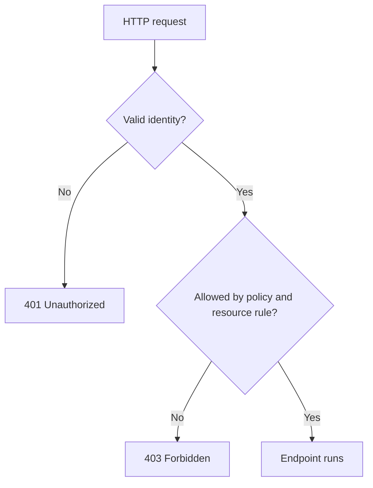

# ASP.NET Core API Contracts, Validation, Authentication, and HTTP Responses

**Category:** Software Engineering / C# / ASP.NET Core  
**Topics:** Authentication, authorization, DTOs, validation, HTTP status codes, API testing  
**Example:** Securing and testing an Employee API

## Overview

An API contract is the agreement between a client and server about routes, input, output, security, and errors. ASP.NET Core endpoints should validate untrusted input, authenticate the caller, authorize each protected action, and return a status code that describes the outcome. These responsibilities work together but answer different questions.

## 1. Authentication and authorization

- **Authentication** establishes who the caller is, often from a bearer token, cookie, or another configured credential.
- **Authorization** decides whether that authenticated identity may perform a specific action on a resource.

A successful login or valid token does not automatically grant access to every employee record. Policies, roles, claims, and resource ownership rules determine the permission.



A `401` response means valid authentication credentials are absent or not accepted. A `403` response means the caller is authenticated but lacks permission. Some systems intentionally return `404` for a resource a caller may not discover; apply that policy consistently and avoid leaking cross-owner records.

## 2. Configure and apply authorization

Authentication handlers are registered according to the application’s identity provider and token or cookie format. The exact scheme must match the deployment and client.

```csharp
builder.Services
    .AddAuthentication(JwtBearerDefaults.AuthenticationScheme)
    .AddJwtBearer(options =>
    {
        options.Authority = builder.Configuration["Authentication:Authority"];
        options.Audience = builder.Configuration["Authentication:Audience"];
    });

builder.Services.AddAuthorization(options =>
{
    options.AddPolicy("EmployeeReader", policy =>
        policy.RequireAuthenticatedUser()
              .RequireClaim("permission", "employees.read"));
});
```

Do not accept tokens by merely decoding them; the configured handler must validate issuer, signature, audience, and lifetime. Keep signing keys and client secrets in secret storage, not source control.

```csharp
[ApiController]
[Route("api/employees")]
public sealed class EmployeesController : ControllerBase
{
    [HttpGet("{id:int}")]
    [Authorize(Policy = "EmployeeReader")]
    public async Task<ActionResult<EmployeeResponse>> GetById(
        int id,
        CancellationToken cancellationToken)
    {
        var employee = await _employees.GetByIdAsync(id, cancellationToken);
        if (employee is null)
        {
            return NotFound();
        }

        return Ok(new EmployeeResponse(employee.Id, employee.Name, employee.Department));
    }
}
```

Authorization should also check resource ownership where relevant. A broad “authenticated” policy alone does not prove a user may read every employee record.

## 3. Request DTOs, response DTOs, and persistence models

A **DTO** (data transfer object) defines data crossing a boundary. A request DTO describes permitted client input. A response DTO describes deliberately exposed output. A persistence model describes database storage or row mapping. Keep these shapes separate when doing so prevents accidental field exposure or couples the API to database changes.

```csharp
public sealed record CreateEmployeeRequest(
    [property: Required, StringLength(100)] string Name,
    [property: Required, StringLength(80)] string Department);

public sealed record EmployeeResponse(
    int Id,
    string Name,
    string Department);

public sealed class Employee
{
    public int Id { get; init; }
    public string Name { get; init; } = "";
    public string Department { get; init; } = "";
    public string InternalPayrollCode { get; init; } = "";
}
```

The response excludes `InternalPayrollCode` by design. Do not bind persistence entities directly from public request bodies when that could let callers set server-owned fields such as IDs, audit data, ownership, or internal flags.

With `[ApiController]`, invalid model state typically produces an automatic `400` response. For complex rules, use an explicit validator or application-level checks; database constraints remain necessary because validation can be bypassed by concurrent requests or other write paths.

Validation should be layered sensibly:

1. Validate request shape and simple field constraints at the API boundary.
2. Apply business rules in the application/domain layer.
3. Enforce durable integrity rules in the database.

## 4. Choosing HTTP status codes

| Situation | Typical response | Meaning |
|---|---:|---|
| Read or update succeeds | `200 OK` | Response includes a representation or result |
| New employee created | `201 Created` | Resource created; include its location when available |
| Delete succeeds without a body | `204 No Content` | Operation succeeded with no response representation |
| Request is malformed or validation fails | `400 Bad Request` | Input cannot be accepted as sent |
| Caller is unauthenticated or credentials invalid | `401 Unauthorized` | Authentication is required or failed |
| Caller lacks permission | `403 Forbidden` | Identity is known but action is denied |
| Employee does not exist or is intentionally hidden | `404 Not Found` | Target is not available to this caller |
| Unexpected server failure | `500 Internal Server Error` | Server could not complete the request |

For a lookup, a repository result of `null` can represent a genuine missing employee; a database exception represents an unsuccessful operation. Do not turn an infrastructure failure into `404`. See the [exception handling handbook](csharp-aspnet-core-exception-handling-dapper.md) and [exception propagation guide](csharp-aspnet-core-exception-propagation-part-2.md).

A controller can express common outcomes clearly:

```csharp
[HttpPost]
[Authorize(Policy = "EmployeeWriter")]
public async Task<ActionResult<EmployeeResponse>> Create(
    CreateEmployeeRequest request,
    CancellationToken cancellationToken)
{
    var created = await _employees.CreateAsync(request, cancellationToken);
    var response = new EmployeeResponse(created.Id, created.Name, created.Department);
    return CreatedAtAction(nameof(GetById), new { id = created.Id }, response);
}
```

Use a consistent error body, such as Problem Details, and avoid returning stack traces, SQL text, secrets, or internal exception details to callers. The application's centralized error handling policy is covered in the existing exception guides.

## 5. Testing contracts and security behavior

A layered test strategy gives different evidence at each boundary:

| Test level | What it checks | Example |
|---|---|---|
| Service unit test | Business rule with controlled dependencies | Employee cannot be assigned to a closed department |
| Repository integration test | SQL, schema, parameters, and mapping | Dapper query maps an employee row correctly |
| API integration test | Routing, serialization, validation, auth, status, error contract | Missing or invalid token gets `401`; valid but disallowed user gets `403` |

Test both allowed and denied cases. Include a cross-owner/resource test so a user cannot access another user’s records by changing an ID. Avoid tests that only verify that a private helper was called when the important contract is the returned response and persisted result.

Interfaces help when they define a meaningful boundary that a caller needs to substitute, such as `IEmployeeRepository` consumed by `EmployeeService`. Do not add an interface for every class automatically: testability is achieved through useful seams, not interface count. Test repositories against a real compatible database when query semantics matter; a mock cannot validate SQL syntax or schema behavior.

## Summary

- Authentication establishes identity; authorization applies permission rules to actions and resources.
- DTOs define API input and output. Persistence models describe storage.
- Validate at the boundary, enforce business rules in the application, and protect data integrity in the database.
- Use `401` for failed/missing authentication and `403` for authenticated callers who are denied.
- A real missing record can be `404`; a failed database operation is an error.
- Test service behavior, Dapper/database behavior, and the HTTP contract at the layer that can prove each one.

## References

- [ASP.NET Core authentication](https://learn.microsoft.com/aspnet/core/security/authentication/)
- [ASP.NET Core authorization](https://learn.microsoft.com/aspnet/core/security/authorization/introduction)
- [Web API controllers and validation](https://learn.microsoft.com/aspnet/core/web-api/)
- [Problem Details in ASP.NET Core](https://learn.microsoft.com/aspnet/core/fundamentals/error-handling-api)
- [HTTP status codes](https://developer.mozilla.org/docs/Web/HTTP/Status)
- [Backend API and microservices engineering handbook](backend-api-microservices-engineering-handbook.md)
