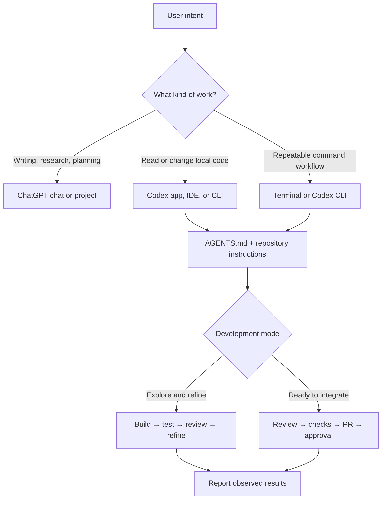
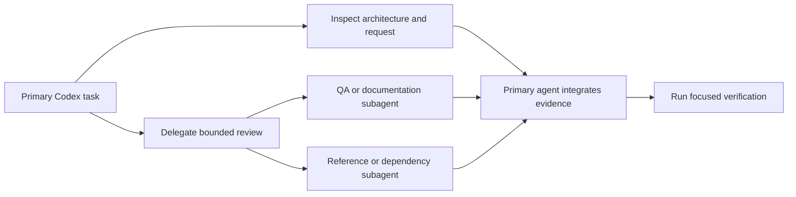
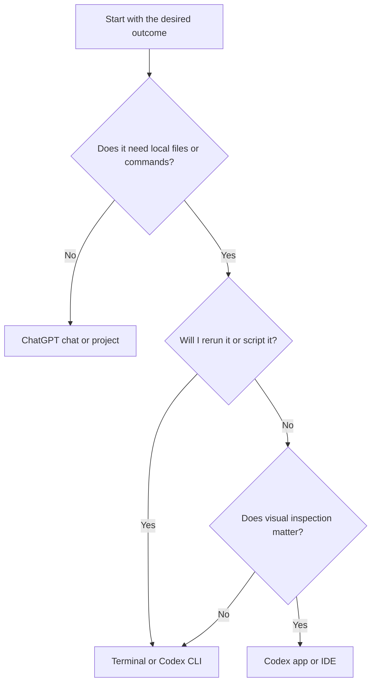

# 🤖 Codex Development Handbook

## Page 1: Purpose

This handbook is a practical reference for using Codex as a development partner across the GemsForge workspace. It explains how to give Codex useful context, how to choose between the app, terminal, IDE, ChatGPT, projects, and chats, and how to keep agent work safe, reviewable, and aligned with the user’s authority.

This guide is about using Codex and ChatGPT Work. It is not an OpenAI API implementation guide, and it does not replace repository-specific governance.

## The short version

Use Codex for work that needs a coding agent: inspect files, edit code, run commands, test changes, review a diff, or prepare a handoff.

Use ChatGPT when the work is primarily conversation, research, planning, writing, or a deliverable that does not need a local coding workspace.

Use a project when the work needs a durable home for related chats, files, and instructions.

Use a chat when the work is a focused conversation or one bounded task.

Use the terminal when the work is repeatable, inspectable, scriptable, or naturally expressed as commands.

Use the Codex app when the work benefits from an interactive workspace, visual review, browser panels, file navigation, or a continuing development thread.

## Page 2: 🧭 The operating map



## Page 3: 1. Instructions: give Codex the map first

Codex should inspect the applicable instructions before changing code. In this workspace, the instruction path begins with `AGENTS.md`, then the operating standard, then the relevant architecture and governance documents.

### ✅ What an instruction file should answer

- What the project is and where the relevant code lives.
- Which architecture and naming rules apply.
- Which commands verify the work.
- Which changes require approval.
- What must not be inferred or changed.
- How exploratory work differs from formal delivery.

### ✅ Recommended instruction hierarchy

```text
Workspace AGENTS.md
    ↓
Repository or project AGENTS.md
    ↓
Directory-specific instructions
    ↓
Issue, story, or user request
    ↓
Current files and test evidence
```

The user request defines the goal. Instruction files define the operating boundaries. Existing code, tests, and tool output provide evidence. A page, comment, screenshot, or generated artifact may provide useful context, but it does not silently override governing instructions.

Codex CLI discovers project instructions from the project root down to the current working directory and combines them in that order. A more local `AGENTS.md` can add directory-specific guidance. Keep this inheritance in mind when a task behaves differently in a nested folder.

### ✅ Keep instructions maintainable

Put durable rules in `AGENTS.md` or the project’s established policy file. Put task-specific context in the prompt or issue. Do not turn every preference into a permanent rule.

```text
Durable rule: Use Avenir Next and the GemsForge palette in local booklets.
Task context: Add a glossary to the database handbook.
Evidence: The generated HTML contains the expected heading and links.
```

## Page 4: 2. Agents and subagents

An agent is a working role with a goal, context, tools, and a responsibility boundary. A subagent is a delegated piece of work that should return evidence or a focused result to the main task.

Delegation is not implied by a request for depth or thoroughness. Spawn a subagent only when the user or applicable instructions authorize delegation, and give it a bounded task with a clear write scope or read-only result.

### ✅ Use one primary agent when

- The work has a single coherent implementation path.
- Changes must be coordinated across several files.
- The agent needs to make decisions from the same evolving context.
- The user is iterating on visual or written feedback.

### ✅ Use subagents when

- Parts of the work are independent.
- A second perspective is useful for review, accessibility, security, or documentation quality.
- One agent can inspect while another prepares a bounded change.
- Parallel research will shorten the task without creating conflicting edits.



### ❌ Do not delegate ownership

Subagents may investigate, draft, test, or review. They do not gain authority to merge, deploy, change permissions, mutate external records, close issues, or approve delivery unless the user explicitly authorizes that action and the workflow allows it.

### ✅ Good subagent request

```text
Review only the generated HTML for missing headings, links, Mermaid blocks, and broken internal anchors.
Do not edit files. Return the failures with exact filenames and evidence.
```

### ❌ Weak subagent request

```text
Make the documentation better.
```

The second request has no boundary, success condition, or handoff format.

## Page 5: 3. Getting the most out of Codex

Codex works best when the prompt describes the outcome, the scope, and the evidence expected at the end.

### 📝 A useful task packet

```text
Goal:
  What should exist when this is complete?

Scope:
  Which files, project, page, or feature are in scope?

Reference:
  Which architecture, issue, image, or document should guide the work?

Constraints:
  What must remain unchanged? What requires approval?

Acceptance:
  What should I be able to see, run, click, or verify?

Report:
  List changed files, checks run, failures, limitations, and next action.
```

### ✅ Give feedback by pointing to evidence

```text
The flowchart is still rendered as a code block in the HTML at the Request flow section.
Convert that source block to Mermaid, regenerate the page, and verify the SVG/runtime path.
```

### ✅ Ask for the smallest useful change

Start with one page, one workflow, one component, or one handbook section. Small iterations keep the result visible and make corrections inexpensive.

### ✅ Ask Codex to explain uncertainty

Useful phrases include:

- “Distinguish what you verified from what you inferred.”
- “Show me the exact file and line that owns this behavior.”
- “Do not implement the fix yet; diagnose the cause first.”
- “Stop before merge, deployment, or external mutation.”

## Page 6: 4. Iterative development versus formal delivery

These are different modes, not different levels of quality.

### 🧪 Iterative development

Use this mode for exploration, UI refinement, troubleshooting, and feedback-driven construction.

```text
Prompt → Build → Test → Review results → Refine → Repeat
```

It does not require a new issue, commit, or pull request for every small refinement unless the repository or user specifically requires one.

### ✅ Formal delivery

Use this mode when the implementation is ready for integration.

```text
Finalize → Test → Independent review → Resolve findings → Pull request → Human approval → Merge
```

Formal delivery requires evidence, applicable branch and commit rules, required checks, issue linkage, and human approval. Codex should stop at the approval boundary rather than silently merging or releasing.

## 5. UI, terminal, IDE, and CLI

| Surface | Best for | Remember |
|---|---|---|
| Codex app | Multi-file implementation, visual review, browser panels, task continuity | Keep the working context and user feedback together. |
| Codex CLI | Repeatable terminal work, scripts, batch transforms, local inspection | Make commands inspectable and rerunnable. |
| IDE extension | Editing while staying inside the code editor | Review the diff and test output in the repository’s normal tools. |
| Terminal | Git, tests, builds, search, formatters, and diagnostics | A command result is evidence, not automatically acceptance. |
| ChatGPT | Research, planning, writing, explanation, and non-local deliverables | Use a project when the context should persist. |
| ChatGPT Work | Longer-running deliverables, recurring work, and reviewable progress | Treat external actions and approvals as explicit boundaries. |

### ✅ Choose the surface by the shape of the work



## 6. ChatGPT projects and chats versus Codex projects and chats

These names are related but should not be treated as the same workspace.

| Concept | Practical meaning |
|---|---|
| ChatGPT chat | A conversation for questions, research, writing, planning, or a focused deliverable. |
| ChatGPT project | A durable collection of related chats, files, sources, and project instructions. |
| Codex chat/task | A coding-oriented working thread with a local or remote development context. |
| Codex project | The saved project/workspace that provides a repository or folder context for Codex work. |
| Codex worktree | An isolated Git checkout used when work must be separated from another checkout. |
| Project instructions | Persistent guidance applied within the project’s scope. |
| Chat prompt | Immediate context for the current request. |

### ✅ Use a project for continuity

Create or use a project when several tasks share:

- the same codebase or document collection;
- the same instructions and vocabulary;
- recurring decisions or reference files; or
- a long-running outcome that should remain easy to resume.

### ✅ Use a separate chat for a clean decision boundary

Use a separate chat when the work needs a fresh context, an independent review, a different project, or a clearly separate deliverable.

### ❌ Do not assume history is authority

A previous chat can explain intent, but current files, current instructions, current checks, and the current user request are stronger evidence of present state.

## 7. My automation patterns

Automation is useful when it removes repeated checking without hiding state or taking an unauthorized action.

### 🫀 Thread follow-up or heartbeat

Use a thread-attached recurring follow-up when Codex should revisit the same task, monitor a known condition, or continue work later. Keep unchanged-state runs quiet; notify only on a meaningful change, completion, failure, or required user action.

### 🗓️ Scheduled or recurring work

Use a standalone scheduled run when the work should execute independently on a recurring schedule, such as a digest, report, or repository scan.

### ✅ Automation checklist

- Name the automation by its human purpose.
- State what it checks and what counts as a meaningful change.
- Identify the source of truth.
- Keep credentials and secrets out of the prompt.
- Define whether it may edit, message, create, or only report.
- Preserve the user’s notification preference.
- Include a quiet no-change path.
- Record limitations when data or permissions are unavailable.

### My documented operating pattern

The GemsForge operating model uses recurring development and Scrum-oriented checks, but automation output is still a dated observation. Confirm the current automation configuration in the Codex app before treating a schedule or delivery state as live truth.

```text
No meaningful change → stay quiet
Meaningful change → report the delta and evidence
Blocked or failed → report the blocker and required action
Approval boundary → stop and ask the user
```

## 8. Safety, permissions, and approval boundaries

Codex can help prepare changes, but the user retains final authority over:

- merging protected branches;
- deployment and release;
- secrets, credentials, and permissions;
- destructive cleanup or history rewriting;
- issue closure and project-state mutation;
- external messages or records; and
- production data and private APIs.

### ✅ Safe default

Inspect first. Make the smallest scoped change. Verify proportionally. Report exact evidence. Stop before an external or irreversible action unless it is explicitly authorized.

### ❌ Do not confuse capability with authorization

The fact that a tool can open a browser, call an app, edit a file, send a message, or mutate a project does not mean that action is approved for the current task.

## 9. A reusable Codex review prompt

```text
Review this change against the applicable AGENTS.md, architecture, and acceptance criteria.

Check:
- correctness and scope;
- type safety and contracts;
- security and privacy boundaries;
- accessibility and responsive behavior;
- tests, formatting, and build evidence;
- documentation and links;
- generated artifacts and source synchronization.

Do not merge, deploy, close the issue, or mutate external project state.
Return findings by severity with exact file paths and evidence.
```

## 10. Glossary

| Term | Meaning |
|---|---|
| Agent | A role with a goal, context, tools, and responsibility boundary. |
| Subagent | A delegated agent used for a bounded investigation, implementation, or review. |
| AGENTS.md | A project instruction file that tells coding agents how to work safely and consistently. |
| Context packet | The goal, scope, references, constraints, acceptance criteria, and reporting format supplied to Codex. |
| Iterative development | Prompt-driven build, test, review, and refinement without unnecessary delivery overhead. |
| Formal delivery | The controlled path from finalized change through review, checks, pull request, approval, and merge. |
| Project | A durable workspace for related files, instructions, chats, or repository context. |
| Chat | A conversation or task thread with a bounded history and working context. |
| Worktree | An isolated Git checkout used to separate development changes. |
| Heartbeat | A recurring follow-up attached to an ongoing thread or task. |
| Scheduled work | A recurring or one-time run that executes independently on a schedule. |
| Evidence | Observable file content, command output, test result, link, screenshot, or tool response. |
| Approval boundary | The point where Codex must stop before merge, deployment, external mutation, or another consequential action. |

## Supportive references

- [Codex — OpenAI Developers](https://developers.openai.com/learn/codex) — Codex app, CLI, IDE, and learning resources.
- [Using Codex with your ChatGPT plan](https://help.openai.com/en/articles/11369540-using-codex-with-your-chatgpt-plan) — access, usage, and project instruction basics.
- [Projects in ChatGPT](https://help.openai.com/en/articles/10169521-projects-in-chatgpt) — project files, instructions, sources, memory, and moving chats.
- [ChatGPT Work and Codex](https://help.openai.com/en/articles/20001275/) — distinctions between Work and Codex history and workflows.
- [OpenAI CLI](https://developers.openai.com/api/docs/libraries/openai-cli) — repeatable CLI work and the CLI-versus-subagent distinction.
- [Docs MCP](https://developers.openai.com/learn/docs-mcp) — connecting Codex to current OpenAI developer documentation.
- [Codex AGENTS.md discovery](https://github.com/openai/codex/blob/main/codex-rs/core/src/agents_md.rs) — project-root-to-working-directory instruction loading.
- [Codex multi-agent specification](https://github.com/openai/codex/blob/main/codex-rs/core/src/tools/handlers/multi_agents_spec.rs) — delegation boundaries and parallel-work guidance.
- [GemsForge Development Operating Standard](../../governance/GemsForge-Development-Operating-Standard.md) — local development modes and approval boundaries.
- [AGENTS.md](../../AGENTS.md) — workspace-specific instructions.

## Closing rule

Give Codex a clear map, a bounded mission, and a visible definition of done. Let it inspect, build, test, and explain. Keep authority, approval, and evidence explicit.
