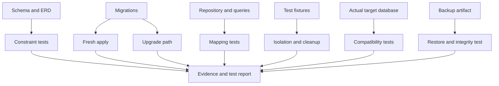

# 🧪 Database Testing Handbook

## Page 1: Purpose

This handbook is a practical reference for proving that a database preserves the rules the application depends on. It complements the Database Engineering Handbook: that book explains how to design the schema; this one explains how to challenge the schema, migrations, queries, fixtures, and recovery process.

## The short version

- Test the database rules where they actually live: constraints in the database, behavior in the repository, and workflows across the API.
- Use a disposable FIT database and isolated fixtures.
- Test both a fresh database and an existing database upgraded through migrations.
- Treat SQLite compatibility as useful evidence, not proof that PostgreSQL behaves identically.
- Keep restore testing separate from ordinary application tests.

## Page 2: The practical minimum

You do not run every test in this handbook for every change.

```text
Every database change:
  1. Test the changed constraint or query.
  2. Test the migration against a disposable database.
  3. Test the important success and failure result.
  4. Keep fixtures isolated.

Migration or schema change:
  Add fresh-apply and upgrade-path checks.

Production database or recovery change:
  Add target-database compatibility and restore checks.
```

The remaining sections are a menu for choosing the evidence that matches the risk—not ten mandatory test suites.

## Page 3: 🧭 Database test map



## Page 4: 1. Foreign-key enforcement

A foreign key should reject a child row that points to a parent that does not exist. Test the database constraint directly, not only the API validation.

For SQLite, enable foreign keys on every test connection before running the test. SQLite does not guarantee foreign-key enforcement merely because the table declares a foreign key.

```sql
CREATE TABLE Accounts (
    AccountID TEXT PRIMARY KEY
);

CREATE TABLE Transactions (
    TransactionID TEXT PRIMARY KEY,
    AccountID TEXT NOT NULL,
    Amount NUMERIC NOT NULL,
    FOREIGN KEY (AccountID) REFERENCES Accounts(AccountID)
);

PRAGMA foreign_keys = ON;

-- This must fail because account-missing does not exist.
INSERT INTO Transactions (TransactionID, AccountID, Amount)
VALUES ('transaction-1', 'account-missing', 25.00);
```

✅ Evidence: the insert fails with a foreign-key violation and no transaction row is created.

## Page 5: 2. Uniqueness and nullability

Test both required values and values that must be unique. A UI check is helpful, but the database must remain the final protection.

```sql
CREATE TABLE Users (
    UserID TEXT PRIMARY KEY,
    Email TEXT NOT NULL UNIQUE,
    DisplayName TEXT NOT NULL
);

INSERT INTO Users (UserID, Email, DisplayName)
VALUES ('user-1', 'diamond@example.com', 'Diamond');

-- Must fail: duplicate email.
INSERT INTO Users (UserID, Email, DisplayName)
VALUES ('user-2', 'diamond@example.com', 'Another name');

-- Must fail: required display name is missing.
INSERT INTO Users (UserID, Email, DisplayName)
VALUES ('user-3', 'new@example.com', NULL);
```

## Page 6: 3. Migration apply-order tests

Migrations are a sequence, not a collection of unrelated table scripts. Test that they apply in order on an empty database and produce the expected schema.

```text
Given an empty FIT database
When every migration runs in its recorded order
Then the migration history contains every expected version
And the final tables, columns, indexes, and constraints exist
And the application can start against the result
```

❌ Do not test only the latest schema snapshot. That can hide a broken migration that fails on a real upgrade.

## 4. Fresh database versus upgrade path

Run two different tests:

| Path | What it proves |
|---|---|
| Fresh apply | A new installation can build the complete schema. |
| Upgrade path | Existing user data survives every migration in order. |

```text
Fresh path:
  empty database → all migrations → schema assertions

Upgrade path:
  migration N database + representative data → migrations N+1…latest → data and schema assertions
```

The upgrade fixture should include old rows, nullable legacy values, relationships, and any data that the migration transforms.

## 5. Transaction rollback

If a multi-step operation fails, the database should not keep half of the change.

```text
Begin transaction
  Create transaction header
  Create transaction detail
  Force a detail constraint failure
Rollback

Assert:
  header does not exist
  detail does not exist
  unrelated records are unchanged
```

✅ A good rollback test proves the final database state, not merely that an exception was thrown.

## 6. Query and model mapping

A query can succeed while mapping the wrong column, dropping a nullable value, or converting a date incorrectly. Test the returned model and the persisted values.

```text
Given a transaction with:
  Amount = 25.50
  Status = 'pending'
  CreatedAt = a known UTC instant

When the repository loads the transaction
Then Amount remains 25.50
And Status remains pending
And CreatedAt remains the same instant
And AccountID remains the owning account
```

Test inserts, reads, updates, deletes, filters, sorting, pagination, and empty results through the repository boundary.

## 7. SQLite and PostgreSQL compatibility

SQLite is excellent for fast local and unit tests, but it is not identical to PostgreSQL. Run portability tests on both when PostgreSQL is the production target.

| Concern | Compatibility check |
|---|---|
| Types | Dates, decimals, booleans, and identifiers preserve their meaning. |
| Constraints | Foreign keys, uniqueness, nullability, and checks behave as intended. |
| Queries | Filtering, ordering, joins, pagination, and case behavior match. |
| Transactions | Commit and rollback behavior matches the application assumption. |
| Concurrency | Locking and concurrent writes are tested on the actual server database. |

✅ SQLite success means the portable part passed. It does not replace a PostgreSQL FIT run.

## 8. Fixture isolation and cleanup

Every test should own its data and leave the database ready for the next test.

```text
Before each test:
  create a unique account and test records

Run the test:
  use only the records created by this test

After each test:
  rollback the transaction or delete the fixture records

Assert:
  another test cannot see this test's data
```

❌ Do not use production data, shared mutable IDs, test-order assumptions, or a fixture that one test silently changes for another.

## 9. ERD-to-schema verification

The ERD is a design contract. Compare the diagram with the actual schema before a migration is considered complete.

```text
For every ERD entity:
  table exists
  primary key exists
  required attributes exist with the intended type
  relationships have matching foreign keys
  cardinality assumptions are enforced where possible

For every schema relationship:
  the ERD documents it or the design decision explains why it is physical-only
```

✅ Store the ERD with the project and update it when tables, relationships, or ownership boundaries change. It helps developers, QA, reviewers, and future migrations reason about the whole data model.

## 10. Backup restore and integrity checks

A backup is not evidence of recoverability until it has been restored and checked.

```text
Create backup artifact
Restore into an isolated database
Run integrity check
Run migration/schema version check
Query representative records
Verify relationships and row counts
Record duration, result, and backup identifier
```

For SQLite, run both checks because they prove different things:

```sql
PRAGMA integrity_check;    -- file, table, index, UNIQUE, CHECK, and NOT NULL integrity
PRAGMA foreign_key_check;  -- foreign-key violations
```

`integrity_check` returning `ok` does not prove that foreign-key relationships are valid. For PostgreSQL, `pg_verifybackup` can detect many backup problems, but it does not replace a real restore. Restore into an isolated database and run representative queries plus application-level checks.

## 11. Swift Testing example

For a Swift/Vapor/Fluent repository, keep the database disposable and assert the final state with Swift Testing. The exact database bootstrapping belongs to the repository, but the test shape should remain recognizable.

```swift
import Testing

@Test
func transactionInsertPersistsOwnerAndAmount() async throws {
    let database = try await TestDatabase.makeIsolated()
    defer { database.cleanup() }

    let account = try await database.insertAccount(id: "account-1")
    let transaction = try await database.insertTransaction(
        accountID: account.id,
        amount: 25.50
    )

    #expect(transaction.accountID == account.id)
    #expect(transaction.amount == 25.50)

    let stored = try await database.findTransaction(id: transaction.id)
    #expect(stored?.accountID == account.id)
    #expect(stored?.amount == 25.50)
}
```

The test should fail if the repository maps the wrong column, loses the owner relationship, rounds the amount incorrectly, or writes to a shared database.

## Minimum database test matrix

| Change | Required evidence |
|---|---|
| New table | Fresh migration, required fields, primary key, constraints, and representative insert/read. |
| New relationship | Foreign-key success and failure, delete/update behavior, and ERD update. |
| New migration | Fresh apply, upgrade path, data preservation, and final schema assertions. |
| Query change | Mapping, empty result, filter/order behavior, and target-database test. |
| Transaction change | Commit success, rollback failure, and unchanged unrelated data. |
| Backup process | Restore, integrity check, representative records, and recorded evidence. |

## Supportive references

- [SQLite foreign key support](https://sqlite.org/foreignkeys.html) — enabling and testing foreign-key enforcement.
- [SQLite PRAGMA integrity_check](https://sqlite.org/pragma.html#pragma_integrity_check) — database integrity verification.
- [SQLite PRAGMA foreign_key_check](https://sqlite.org/pragma.html#pragma_foreign_key_check) — foreign-key violation detection, which is separate from `integrity_check`.
- [PostgreSQL constraints](https://www.postgresql.org/docs/current/ddl-constraints.html) — primary keys, foreign keys, unique constraints, and checks.
- [PostgreSQL backup and restore](https://www.postgresql.org/docs/current/backup.html) — backup and recovery concepts.
- [PostgreSQL `pg_verifybackup`](https://www.postgresql.org/docs/current/app-pgverifybackup.html) — backup verification and why test restores are still required.
- [ASP.NET Core integration tests](https://learn.microsoft.com/en-us/aspnet/core/test/integration-tests) — application/database integration testing patterns.
- [Swift Testing](https://developer.apple.com/xcode/swift-testing/) — Swift test authoring.
- [Database Engineering Handbook](database-engineering-handbook.md) — schema, migration, ERD, and recovery design guidance.

## Closing rule

Test the rules that protect the data, the migration paths that change those rules, and the recovery paths that restore them. A database test is complete when it proves the final state and records enough evidence for another person to trust it.
