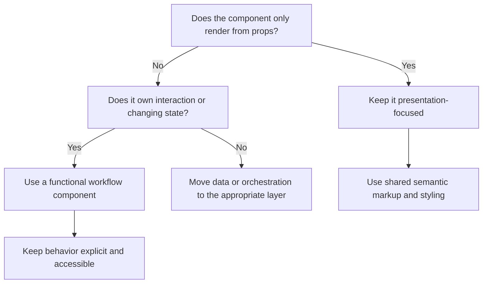

# 🧱 Presentation-Focused and Functional React Components

## Page 1: 🧭 The core idea

In React, a reusable component has a defined contract: it accepts inputs, produces UI, and can optionally manage behavior or state. Function declarations are a common way to implement that contract.

<mark>Key idea:</mark> Function syntax describes implementation. Component responsibility describes the work that belongs inside the component.

Component design becomes clearer when runtime behavior and presentation responsibility are considered separately.

- A **presentation-focused component** describes presentation. It usually has no local state, effects, event orchestration, or data fetching.
- A **functional component** is a JavaScript or TypeScript function that returns JSX. It may focus on presentation, or it may coordinate interaction with props, hooks, and event handlers.

Function syntax supports both presentation-focused components and behavior-oriented components. The component’s responsibility determines which role it plays.

## Page 2: 🎨 Shared Heading components

A shared Heading component is a good example of a presentation-focused component. Its job is to apply the project’s heading semantics and styling consistently.

```tsx
import type { ReactNode } from 'react';

type HeadingProps = {
  children: ReactNode;
  level?: 1 | 2 | 3;
  className?: string;
};

export function Heading({ children, level = 2, className }: HeadingProps) {
  const styles = {
    1: 'text-4xl font-bold tracking-tight',
    2: 'text-3xl font-semibold tracking-tight',
    3: 'text-2xl font-semibold',
  } as const;

  const Tag = `h${level}` as keyof JSX.IntrinsicElements;

  return (
    <Tag className={`${styles[level]} ${className ?? ''}`}>
      {children}
    </Tag>
  );
}
```

The function declaration provides the implementation. The component’s responsibility is presentation: it renders consistent UI from explicit props and keeps state, effects, data loading, and workflow behavior outside its boundary.

### 🏛️ Architecture tip

In a feature-oriented architecture, function syntax describes implementation and presentation-focused design describes responsibility. A shared Heading uses function syntax to provide consistent structure, semantics, accessibility, and styling. The feature supplies the heading’s content and intent; feature state, data fetching, and workflow logic remain in their appropriate layers.

For example, the feature view supplies the meaning:

```tsx
export function EducationView() {
  return (
    <section>
      <Heading level={1}>Education</Heading>
      <p>Review and manage education records.</p>
    </section>
  );
}
```

The shared `Heading` component supplies the reusable implementation details:

```tsx
import type { ReactNode } from 'react';

type HeadingProps = {
  children: ReactNode;
  level?: 1 | 2 | 3;
  className?: string;
};

export function Heading({ children, level = 2, className }: HeadingProps) {
  const headingStyles = {
    1: 'text-4xl font-bold tracking-tight',
    2: 'text-3xl font-semibold tracking-tight',
    3: 'text-2xl font-semibold',
  } as const;

  const Tag = `h${level}` as keyof JSX.IntrinsicElements;

  return (
    <Tag className={`${headingStyles[level]} ${className ?? ''}`}>
      {children}
    </Tag>
  );
}
```

If the visual language changes, the shared Heading styles can change without rewriting `EducationView` or every other feature that uses the component.

## 💬 A practical anecdote

Imagine a Portfolio page where every section title has a slightly different font size, margin, and color. The page still works, but each new section requires another styling decision. Over time, the visual language becomes difficult to maintain.

A shared `Heading` component turns that repeated decision into a small, visible contract. The Portfolio feature chooses the title and heading level. The shared component applies the approved typography, spacing, and semantic element. When the design system changes, one component carries the update across the site.

Later, a product request adds a collapsible section title. The title still benefits from the shared Heading styles, while the collapse button and open/closed state belong to an interactive component. This keeps the original Heading useful and gives the new behavior a clear home.

Usage:

```tsx
<Heading level={1}>Knowledge Hub</Heading>
<Heading level={2}>Component patterns</Heading>
```

Prefer semantic HTML headings over styling a generic element. The visual size and the document outline are separate concerns: a heading can look small while remaining an `h2`, and a large visual title should still use the correct heading level for the page structure.

## Page 3: ⚙️ When a component needs behavior

Use a functional component with hooks or event handlers when the component must respond to runtime changes.

```tsx
import { useState } from 'react';

type ExpandableHeadingProps = {
  title: string;
};

export function ExpandableHeading({ title }: ExpandableHeadingProps) {
  const [open, setOpen] = useState(false);

  return (
    <div>
      <button type="button" onClick={() => setOpen((current) => !current)}>
        {title}
      </button>
      {open ? <div>Additional information</div> : null}
    </div>
  );
}
```

This component is functional in both syntax and responsibility: it owns interaction state and changes what is rendered in response to user input.

Keep hooks and state in the component or workflow that owns the behavior. Keep the shared Heading focused on semantics and styling, then compose it with interactive components when needed.

## Page 4: 🔀 Choosing the right boundary



Use these questions before adding responsibility:

- What is this component responsible for rendering?
- Which inputs does it need from its parent?
- Does it need state, effects, or event handling?
- Could the behavior belong in a feature view or workflow hook?
- Does the markup preserve semantic HTML and keyboard accessibility?

## Page 5: ✅ Practical guidance

For shared styled components:

- Export a clear props type or interface.
- Use semantic elements such as `h1`, `h2`, and `h3`.
- Keep styling tokens and variants in one place.
- Accept `children` and limited extension props when reuse requires them.
- Avoid fetching data or owning feature-specific state.
- Prefer a variant or explicit prop when it expresses the needed difference clearly.
- Test the rendered element, accessible role, and important style variants.

For feature components:

- Let the feature view compose shared presentation components.
- Keep interaction behavior in the feature component or a focused workflow hook.
- Keep data retrieval in the query or data module.
- Pass transformed, explicit data into presentation components.

## Page 6: 🌿 Commit policy for component work

Use a focused issue-numbered branch for formal component work. Keep exploratory refinements local until formal delivery is requested.

<mark>Commit format:</mark>

```text
type(scope): #issue short imperative description
```

Use a repository-approved type such as `feat`, `fix`, `refactor`, `test`, `docs`, or `chore`. Keep the scope lowercase, include a positive issue number, and begin the description with a lowercase imperative word.

Examples for shared component work:

```text
feat(ui): #205 add shared heading component
test(ui): #205 verify heading semantics and variants
docs(architecture): #205 explain presentation-focused components
```

### ✅ Do and 🚫 Don’t

| ✅ Do | 🚫 Don’t |
| --- | --- |
| `feat(ui): #205 add shared heading component` | `added heading stuff` |
| `test(ui): #205 verify heading semantics and variants` | `tests` |
| `docs(architecture): #205 explain presentation-focused components` | `update docs` |
| Use a lowercase scope such as `ui` or `architecture`. | Use vague scopes such as `misc` or `stuff`. |
| Begin with a lowercase imperative verb such as `add`, `verify`, or `explain`. | Begin with a past-tense summary such as `added` or `fixed`. |
| Keep contracts, implementation, tests, and documentation independently reviewable. | Combine unrelated work into one opaque commit. |

Keep commits independently reviewable. Separate contracts, implementation, tests, and documentation when each part can be reviewed on its own. Before formal delivery, verify the issue linkage, branch name, commit subject, focused checks, and remaining risk.

## Page 7: 🤖 Applying commit policy automatically

Automation turns the written policy into a repeatable Git procedure. Use fast local checks for immediate feedback and a required CI check for the shared repository decision.

### Why this helps teams

Commit policy is common in enterprise development because large teams need a predictable record of change. The same practice remains useful for smaller teams, open-source projects, and agent-assisted development. Consistent commit subjects make it easier to understand what changed, connect work to an issue, filter history by area, generate release notes, and identify the right change during troubleshooting.

When multiple people or agents work in the same project, the policy provides a shared language for handoffs. A commit such as `test(ui): #205 verify heading semantics and variants` communicates its purpose before anyone opens the diff. That clarity helps reviewers follow the change and helps automation route checks to the right workflow.

### Local validation

Run the same checks before committing and before pushing:

```sh
# Confirm the branch follows the repository pattern.
git branch --show-current

# Review the staged change before committing.
git diff --cached --check
git diff --cached --stat

# Validate the proposed subject against the commit policy.
git commit -m "feat(ui): #205 add shared heading component"
```

A repository hook can run the subject validator and staged-diff checks automatically. Keep the hook small, fast, and committed with the repository’s development tooling so every contributor can install the same rule.

### CI validation

The pull-request workflow should validate the branch, commit subjects, issue linkage, required labels, and focused tests. A simplified workflow shape is:

```yaml
name: Policy checks

on:
  pull_request:

jobs:
  policy:
    runs-on: ubuntu-latest
    steps:
      - uses: actions/checkout@v4
        with:
          fetch-depth: 0
      - name: Validate branch and commit policy
        run: npm run policy:check
      - name: Run focused component checks
        run: npm run test:components
```

The repository-specific `policy:check` command owns the exact regular expressions, allowed types, issue-number rules, and pull-request metadata. The workflow should report a clear failure message that points to the matching policy example.

### Safe delivery sequence

1. Create the issue-numbered branch.
2. Make a focused change.
3. Run local policy and focused tests.
4. Create a policy-compliant commit.
5. Push the branch and open the linked pull request.
6. Wait for required checks and independent review.
7. Merge only after human approval.

<mark>Automation enforces the rule; it does not grant merge, acceptance, release, or deployment authority.</mark>

## 🔗 References

- [React: Your First Component](https://react.dev/learn/your-first-component)
- [React: Passing Props to a Component](https://react.dev/learn/passing-props-to-a-component)
- [React: Responding to Events](https://react.dev/learn/responding-to-events)
- [React: Managing State](https://react.dev/learn/managing-state)
- [MDN: HTML heading elements](https://developer.mozilla.org/en-US/docs/Web/HTML/Reference/Elements/Heading_Elements)
- [Conventional Commits](https://www.conventionalcommits.org/en/v1.0.0/)
- [commitlint](https://commitlint.js.org/)
- [Git hooks](https://git-scm.com/book/en/v2/Customizing-Git-Git-Hooks)
- [GitHub: About protected branches](https://docs.github.com/en/repositories/configuring-branches-and-merges-in-your-repository/managing-protected-branches/about-protected-branches)
- [GitHub: About pull requests](https://docs.github.com/en/pull-requests/collaborating-with-pull-requests)
