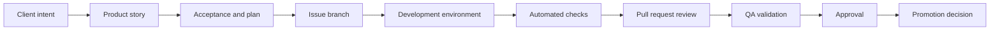

# 🐙 GitHub Project Management Handbook

## Page 1: 🎯 Purpose

This handbook explains how to set up and operate a GitHub repository and Scrum project for a small product team, solo developer, or AI-assisted development team.

It covers the work from client intent to planned story, development branch, verified pull request, and approved promotion. It does not replace a deployment handbook; it defines the project-management flow and the evidence required before promotion.

> 🧬 Guiding principle: Make the work traceable from user need to verified change without creating administrative work that does not improve clarity.

**💬 Client intent → 📝 Story → 🧭 Plan → 🌿 Branch → 💻 Development → 🧪 Verification → 🔍 Review → 🚦 Approval → 📦 Promotion**

## Page 2: 🧭 1. Repository setup

### ✅ Minimum repository setup

- Create the repository with a clear product name and description.
- Keep the default branch protected.
- Add a README with purpose, local setup, supported environments, and current status.
- Add a license when the project’s distribution policy is known.
- Add a `.gitignore` for the language, IDE, operating system, and local secrets.
- Add contribution and development guidance when more than one person or agent will work in the repository.
- Add issue and pull-request templates when recurring information is required.
- Add a documented commit policy and local validation hook where appropriate.
- Add required checks before allowing protected-branch merges.

### 📁 Recommended repository documentation

```text
README.md
CONTRIBUTING.md
SECURITY.md
CHANGELOG.md
.github/
├── ISSUE_TEMPLATE/
│   ├── feature.md
│   ├── bug.md
│   └── task.md
├── PULL_REQUEST_TEMPLATE.md
└── workflows/
    ├── policy-checks.yml
    └── test-and-build.yml
```

### Why these files exist

| File or folder | Why it helps |
|---|---|
| `README.md` | Gives a new contributor the shortest path to understand the product, run it, test it, and find deeper documentation. |
| `CONTRIBUTING.md` | Explains how changes should be proposed, developed, verified, and reviewed when the rules need more detail than the README. |
| `SECURITY.md` | Tells people how to report a vulnerability without exposing it in a public issue. |
| `CHANGELOG.md` | Records meaningful user-facing changes across versions or releases. |
| `.github/ISSUE_TEMPLATE/` | Helps recurring issue types capture the information needed for planning and triage. |
| `feature.md` | Captures user outcome, scope, acceptance criteria, and verification for a new capability. |
| `bug.md` | Captures reproduction steps, expected behavior, actual behavior, impact, and evidence. |
| `task.md` | Captures focused maintenance, documentation, research, or technical work that is not a feature or bug. |
| `PULL_REQUEST_TEMPLATE.md` | Reminds contributors to include outcome, scope, checks, risks, screenshots, and approval needs. |
| `.github/workflows/` | Stores repeatable automated checks that run consistently for pushes and pull requests. |
| `policy-checks.yml` | Validates repository rules such as branch names, commit subjects, issue linkage, labels, or required metadata. |
| `test-and-build.yml` | Runs the relevant tests, type checks, lint, builds, or other evidence needed before review or merge. |

These files are a starting structure, not a requirement to create every file immediately. An MVP repository can begin with `README.md`, one issue template, one pull-request template, and one required check, then grow as the workflow proves what needs to be standardized.

Do not commit secrets, real environment files, credentials, production data, generated private exports, or local database files unless the repository policy explicitly requires a safe fixture.

## Page 3: 🧭 2. Project Scrum board setup

### Recommended project fields

| Field | Purpose | Example values |
|---|---|---|
| Status | Shows lifecycle state | Backlog, Ready, In progress, Review, QA, Done |
| Priority | Shows urgency and value | P0, P1, P2, P3 |
| Type | Shows kind of work | Feature, Bug, Task, Documentation, Security |
| Area | Shows ownership or product location | API, Console, Database, QA, Infrastructure |
| Iteration | Groups work into a sprint or timebox | Sprint 01, Sprint 02 |
| Size | Estimates relative effort and uncertainty for planning | Story points such as 1, 2, 3, 5, 8, 13, or t-shirt sizes XS, S, M, L, XL |
| Risk | Makes uncertainty, impact, or dependency danger visible | Low, Medium, High, Blocked |

### Size or story points

Yes, Size can be the Project’s story-points field. Choose one estimation language and use it consistently; do not maintain both `size:m` and `5 points` for the same purpose unless the relationship is documented.

Story points are relative—not hours. They combine:

- implementation effort;
- technical complexity;
- uncertainty or unknowns; and
- coordination or testing difficulty.

| Points | Relative meaning | Typical example |
|---|---|---|
| 1 | Tiny, understood change | Documentation correction or small copy update |
| 2 | Small, low-risk change | One focused validation rule or isolated UI adjustment |
| 3 | Small feature with a few moving parts | One endpoint plus focused tests |
| 5 | Medium story with multiple boundaries | API, database change, UI state, and verification |
| 8 | Large or uncertain story | Several layers, migration risk, or external dependency |
| 13+ | Too large or too uncertain for one story | Split the work or run a discovery task first |

The exact scale is less important than shared comparison. If the team cannot explain why a story is larger than another, the story may need clearer scope or decomposition.

### Risk criteria

| Risk | Use when | Example |
|---|---|---|
| Low | The change is isolated, reversible, well understood, and has ordinary test coverage. | Copy change or isolated unit test improvement |
| Medium | The change crosses a few layers or has compatibility, data, or accessibility concerns. | New API field consumed by an existing Console screen |
| High | The change affects ownership, authentication, personal data, migrations, shared contracts, or protected workflows. | Live-schema migration or owner-isolation change |
| Blocked | The work cannot proceed until a decision, dependency, permission, environment, or external change is resolved. | Missing credential, undecided contract, or failing required infrastructure |

### Recommended views

- **Backlog:** unscheduled work ordered by value and priority.
- **Current sprint:** work committed for the current timebox.
- **Board:** status columns for daily flow.
- **By area:** grouped by API, Console, database, QA, or other responsibility.
- **Blocked:** issues requiring a decision, dependency, permission, or fix.
- **Release readiness:** work with acceptance, verification, and approval evidence.

### Status meanings

| Status | Meaning | Exit evidence |
|---|---|---|
| Backlog | Captured but not ready or committed | Clear enough to prioritize |
| Ready | Defined and available for development | Scope, acceptance criteria, and dependencies are understood |
| In progress | Active implementation is underway | Branch and current work are visible |
| Review | Implementation is ready for review | PR, checks, and developer evidence exist |
| QA | Merged development work is being validated | Acceptance, regression, accessibility, security, and responsive checks are recorded |
| Done | Acceptance and required approvals are complete | Delivery evidence and closure decision are recorded |
| Blocked | Work cannot proceed without a decision or external change | Exact blocker and next decision are recorded |

Do not infer Project ownership, status, priority, or QA readiness from an assignee alone. Use the Project fields and issue evidence as the source of truth.

## Page 4: 🏷️ 3. Labels

Labels are shared metadata for an issue and its pull request. Their job is to answer a small planning question that is useful when filtering, reviewing, or reporting work.

### Label rule

Apply the same meaningful labels to the working issue and its pull request. GitHub does not automatically copy every issue label to a linked pull request, so check the PR before review.

```text
Issue: feature · api · database
PR:    feature · api · database
```

Do not create a label merely because it sounds useful. Keep a label only when it changes a decision, identifies a review need, or makes a recurring view easier to use. If a label describes lifecycle, urgency, sprint, or effort that already has a Project field, use the Project field instead of duplicating it.

### Minimal starting label set

Start with only the labels that fit the current workflow. This is a practical baseline, not a requirement to create every label listed.

| Label | Function | Use it when |
|---|---|---|
| `feature` | Work type | The change adds a user-visible capability. |
| `bug` | Work type | Existing behavior is incorrect or broken. |
| `task` | Work type | The work is focused maintenance, research, or technical setup. |
| `docs` | Work type | The change is documentation-focused. |
| `security` | Review flag | Authentication, authorization, secrets, privacy, or security risk needs attention. |
| `api` | Area flag | The API, backend service, or public contract is affected. |
| `console` | Area flag | The Console or frontend application is affected. |
| `database` | Area flag | Schema, migrations, queries, or persisted data are affected. |
| `ui` | Area flag | Visual, accessibility, responsive, or interaction behavior is affected. |
| `workflow` | Area flag | Repository, GitHub Project, automation, or development process is affected. |
| `blocked` | Attention flag | Work cannot proceed until an external dependency or decision is resolved. |
| `needs-decision` | Attention flag | Scope, ownership, contract, or implementation direction is unresolved. |
| `ready-for-qa` | Attention flag | Merged work is ready for QA validation. |

You may use fewer labels. For example, a solo project may begin with only `feature`, `bug`, `task`, `docs`, `api`, `console`, `database`, `blocked`, and `needs-decision`. Do not add priority, size, sprint, or status labels when those values already live in Project fields.

### Label decisions

```text
New authenticated user endpoint:
feature · api · security

Broken mobile table focus state:
bug · console · ui

Document migration-test setup:
docs · database

Ownership rule is undecided:
task · api · blocked · needs-decision
```

Use one primary work-type label, then add only the area and attention labels that help someone make a real decision. Avoid labels that duplicate assignees, milestones, Project Status, Priority, Size, or prose.

## Page 5: 📝 4. MVP story creation

An MVP story should describe one valuable outcome that can be developed, verified, and reviewed without guessing.

### Quick issue template

Use this when you need to capture an idea, defect, question, or task quickly. It is intentionally incomplete; refine it into the full story template before marking the issue **Ready** for development.

```markdown
# [type(scope):] short outcome or problem

## Why
What is the user or developer need?

## What I need
- [The smallest useful change, question, or investigation]

## Done when
- [ ] [Observable result]

## Notes
- Labels:
- Related issues or links:
- Questions, risks, or blockers:
```

The fastest acceptable version is a clear title, one sentence explaining why it matters, and one observable result. Do not wait for perfect wording before recording useful work.

### Story template

```markdown
# [type(scope):] imperative outcome

## User outcome
As a [user], I want [capability] so that [value].

## Scope
- [Included behavior]

## Non-goals
- [Explicitly deferred behavior]

## Acceptance criteria
- [ ] [Observable behavior]
- [ ] [Validation, error, or permission behavior]
- [ ] [Accessibility or responsive behavior when UI changes]
- [ ] [Data, migration, or security boundary when applicable]

## Relationships
- Parent:
- Blocked by:
- Blocks:

## Verification
- Automated:
- Manual:
- Security/privacy:
- Accessibility/responsive:

## Stop condition
Stop after the listed checks and return the delivery report. Do not merge,
deploy, close the issue, or change Project state without approval.
```

### MVP story rules

- Start with the smallest end-to-end outcome, not a list of technical tasks.
- State what is intentionally not included.
- Make acceptance observable.
- Name the data and ownership boundary.
- Include failure and permission behavior.
- Identify dependencies and relationships explicitly.
- Define the checks that will prove the story.
- Give the story a stop condition.

## Page 6: 🌿 5. Branches, commits, and pull requests

### Branch rule

Formal work uses a focused issue-numbered branch. Exploratory work may remain local until formalization is requested.

```text
fix/205-live-metadata-migration
feat/418-shared-actions-standard
docs/500-development-handbook
```

### Commit policy

```text
type(scope): #issue short imperative description
```

Approved types should follow the repository policy, such as `feat`, `fix`, `refactor`, `test`, `docs`, and `chore`. Keep the scope lowercase, include a positive issue number, and begin the description with a lowercase imperative word.

```text
feat(api): #205 add service logo endpoint
test(database): #205 verify logo ownership constraint
docs(workflow): #500 document QA checkpoint
```

Use focused commits for independently reviewable parts such as contracts, implementation, integrations, tests, and documentation. Do not collapse a whole story into one opaque commit.

### Pull request expectations

- Link the working issue.
- Use a title that follows the repository policy.
- State the user outcome and scope.
- List files or areas changed.
- Record automated checks and manual review.
- Identify blockers and remaining risk.
- Keep merge, deploy, issue closure, and Project changes as separate approvals.

## 🔒 6. Protecting branches

Protect the default branch and any release or production branch.

### Minimum protections

- Require pull requests before merging.
- Require the relevant status checks to pass.
- Restrict direct pushes.
- Restrict review bypass permissions.
- Require a review when the repository risk warrants it.
- Require branches to be up to date when the workflow depends on current target-branch behavior.
- Preserve signed or verified commits when that is part of the repository policy.
- Keep Actions permissions least-privileged.
- Protect production environments and secrets separately.

Branch protection does not replace code review, QA, security review, or explicit approval. A green check proves only what that check tested.

## 📚 7. Supporting GitHub documentation

These references support the workflow described in this handbook. GitHub changes its interface and available features over time, so use the current GitHub documentation when a setting name or screen differs from this guide.

### Repository, issues, labels, and pull requests

- [Planning and tracking work for your team or project](https://docs.github.com/en/issues/tracking-your-work-with-issues/learning-about-issues/planning-and-tracking-work-for-your-team-or-project) — how repositories, issues, and Projects fit together.
- [Using labels and milestones to track work](https://docs.github.com/en/issues/using-labels-and-milestones-to-track-work) — creating, applying, filtering, and maintaining labels for issues and pull requests.
- [About issue and pull request templates](https://docs.github.com/en/communities/using-templates-to-encourage-useful-issues-and-pull-requests/about-issue-and-pull-request-templates) — standardizing the information contributors provide.
- [Configuring issue templates for your repository](https://docs.github.com/en/communities/using-templates-to-encourage-useful-issues-and-pull-requests/configuring-issue-templates-for-your-repository) — including default titles, labels, types, and assignees.
- [Planning and tracking with Projects](https://docs.github.com/en/issues/planning-and-tracking-with-projects) — views, fields, automation, and reporting for GitHub Projects.

### Branches, checks, and workflows

- [About protected branches](https://docs.github.com/en/repositories/configuring-branches-and-merges-in-your-repository/managing-protected-branches/about-protected-branches) — required reviews, status checks, signed commits, merge queues, and bypass controls.
- [Managing a branch protection rule](https://docs.github.com/en/repositories/configuring-branches-and-merges-in-your-repository/managing-protected-branches/managing-a-branch-protection-rule) — configuring the protection behavior for a branch or branch pattern.
- [Understanding GitHub Actions](https://docs.github.com/en/actions/get-started/understand-github-actions) — workflows, events, jobs, steps, runners, and reusable actions.
- [Workflows](https://docs.github.com/en/actions/concepts/workflows-and-actions/workflows) — the structure and purpose of workflow files in `.github/workflows/`.
- [Secure use reference](https://docs.github.com/en/actions/reference/security/secure-use) — least-privilege permissions, secrets, third-party actions, and untrusted code risks.

Use these references to verify the current GitHub behavior; use this handbook to decide how those features fit the GemsForge workflow.

## 🔄 8. From client request to promotion



### Client to story

Translate the request into an outcome, scope, non-goals, acceptance criteria, dependencies, risks, and verification. Do not turn an ambiguous request directly into implementation tasks.

### Story to development

Create or update the issue, assign the Project fields, create the issue branch, and report a checkpoint before materially ambiguous work. Keep implementation focused on that story.

### Development to review

Run the narrowest relevant checks first. Record the exact commands, results, affected files, and blockers. Open a PR only when authorized and when the evidence is ready to review.

### Review to QA

Review checks, code, acceptance criteria, security, privacy, accessibility, responsive behavior, and regression risk. QA validates merged development code and reports evidence; QA does not merge, release, or close the story without authorization.

### QA to promotion

Promotion requires a separate decision. This handbook records the project and approval flow; the deployment handbook will define the technical release and hosting procedure.

## 📊 9. Delivery reports and checkpoints

### Development checkpoint

```text
Goal:
Acceptance criteria:
Branch:
Files changed:
Checks run:
Manual review:
Risks and blockers:
Stop condition:
```

### Sprint delivery report

```text
Sprint goal:
Delivered:
Outstanding:
Verification:
Approval decision:
Recommended next sprint:
```

The report should distinguish delivered work, outstanding work, evidence, risks, and the next approval decision. It is not permission to merge or deploy.

## 🧩 10. MVP GitHub setup

Start with:

1. One repository.
2. One protected default branch.
3. One Scrum Project.
4. A small, documented label set.
5. One story template and one bug template.
6. One commit policy.
7. One required test or policy check.
8. A clear issue → branch → commit → PR relationship.
9. A development checkpoint and delivery report.
10. Explicit approval before merge, release, closure, or Project mutation.

Add automation only when the manual workflow is understood and the automation removes repeated work without hiding state.

## 📚 11. Glossary

- **Acceptance criteria:** Observable conditions that prove a story outcome is complete.
- **Branch protection:** Rules that prevent unsafe direct changes to a protected branch.
- **Checkpoint:** A structured progress record for plan, implementation, verification, or PR work.
- **Issue branch:** A focused branch associated with one story or change.
- **MVP:** The smallest valuable, testable outcome that establishes a safe foundation for future work.
- **Project field:** Structured metadata used to filter, sort, group, and report work.
- **Promotion:** Moving verified work toward another environment or release stage.
- **QA:** Validation of merged development code against acceptance criteria and regression risks.
- **Story:** A user-centered unit of planned work with scope, acceptance, relationships, and verification.
- **Stop condition:** The explicit point where work pauses and returns evidence for a decision.

