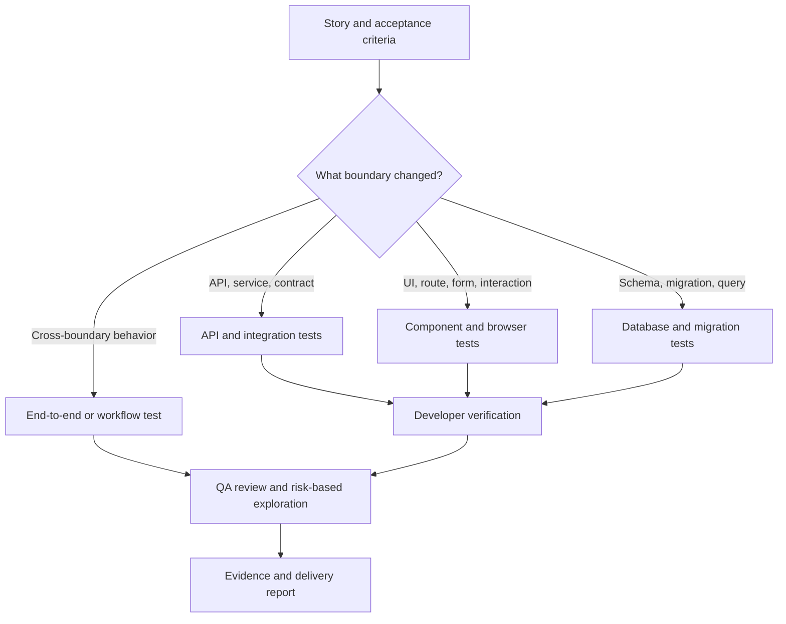

# 🧪 Testing and QA Handbook

## Page 1: Purpose

This handbook explains how GemsForge tests software across API, database, UI, and workflow boundaries. It is a practical guide for deciding what a test should prove, who should run it, and what evidence makes a quality claim trustworthy.

Testing is not only “does the code run?” Testing asks whether the system behaves correctly for real users, real data boundaries, invalid input, failure, change, and recovery.

## The short version

- Developers prove that the code they changed behaves according to its contract.
- QA proves that the product behavior satisfies the story and remains safe across boundaries.
- API tests prove service behavior without depending on a browser.
- UI tests prove user-visible behavior without duplicating every backend implementation detail.
- Good tests explain a risk and fail for a meaningful reason.
- Passing tests are evidence, not permission to merge, deploy, or release.

## Page 2: 🧭 Testing map



## Page 3: 1. API testing versus UI testing

API and UI tests are related, but they answer different questions.

| Test boundary | Main question | Best evidence | Example |
|---|---|---|---|
| API/unit | Do a function, service, validator, or policy produce the correct result? | Focused test with controlled inputs and explicit assertions. | `TransactionValidator` rejects `Amount = -5` and returns a named validation error. |
| API/integration | Do routes, authentication, persistence, transactions, and contracts work together? | Request/response test against a disposable or controlled database. | `POST /transactions` returns `201`, saves one owner-scoped row, and returns the response DTO. |
| Contract | Does the producer and consumer agree on shape, status, errors, and meaning? | Schema, contract, or compatibility test. | An OpenAPI response still contains `id`, `amount`, and `createdAt` with the documented types. |
| UI/component | Does a component render and respond correctly to user interaction? | Accessible interaction test with visible state assertions. | A form shows “Amount must be greater than zero” and does not call the save action. |
| UI/browser | Can a user complete the workflow through the route, form, and browser? | Browser test with realistic navigation and recovery. | A user opens `/transactions`, submits the form, sees the saved row, and recovers from a server error. |
| End-to-end | Does the complete path work across client, API, and data boundaries? | Narrow critical-path test with stable test data. | A seeded owner signs in, creates a transaction in the Console, refreshes, and sees the persisted result. |

### ✅ API example

```text
Given an authenticated owner submits a valid transaction
When POST /transactions is called
Then the API returns the documented success status
And the response contains the created transaction contract
And the record belongs to the authenticated owner
```

### ✅ UI example

```text
Given the Transactions page is open
When the user submits the form with a missing amount
Then the amount field exposes an accessible error
And the request is not sent
And the user can correct the field without losing the other values
```

### ❌ Do not duplicate the same proof everywhere

If an API test already proves the exact validation rule, a UI test should prove that the user can see and recover from the validation—not reimplement every server rule in a browser test.

## Page 4: 2. Framework tests versus testing tools

“UI testing” can mean testing a user interface through code or testing it through a visual automation tool. API tools also have different strengths from framework tests.

| Approach | What it is best at | What it should not replace |
|---|---|---|
| Framework tests | Fast, versioned, repeatable unit, component, integration, contract, and browser tests close to the code. | Risk-based exploratory testing and product review. |
| Postman | API requests, collection workflows, response scripts, exploratory failures, and shared API suites. | Unit tests, repository integration tests, authorization coverage, and UI behavior. |
| mabl | Browser/mobile journeys plus API tests, plans, scheduled runs, and deployment-triggered checks. | Focused developer tests, local debugging, and every internal rule. |
| Manual exploratory testing | Investigation of ambiguity, usability, unusual sequences, and new risk. | Repeatable regression coverage. |

### ✅ Practical division of labor

```text
Framework tests → prove code contracts quickly and repeatably
Postman         → prove API requests, responses, workflows, and service behavior
mabl            → prove browser/mobile journeys and selected API workflows
QA exploration  → discover risks scripted tests did not anticipate
```

Postman is an API testing client: requests can contain scripts and collections can be run as suites. mabl can test browser/mobile flows and can also run API tests, including scheduled or deployment-triggered plans. Neither tool makes a test valuable automatically; the assertion, data, environment, and evidence still need review.

### ✅ What belongs in each place

```text
Developer framework test:
  “Does this service reject a negative amount and preserve the database?”

Postman collection:
  “Can an authenticated client create, retrieve, and update a transaction?”

mabl browser test:
  “Can a user complete the form, recover from an error, and see the saved result?”

QA exploration:
  “What happens if the user double-submits, changes the route ID, loses connectivity, or uses a narrow viewport?”
```

### ❌ Do not treat tool coverage as product coverage

- A green Postman collection does not prove that the UI presents the response correctly.
- A green mabl journey does not prove every service rule, migration constraint, or error branch.
- A passing framework test does not prove the workflow is understandable or accessible.
- A manual pass does not create durable regression protection by itself.

Choose the smallest overlapping set that protects the risk: framework tests for fast contracts, Postman or equivalent for API workflows, mabl or equivalent for critical user journeys, and QA exploration for uncertainty.

## Page 5: 3. Test layers and responsibilities

### Unit tests

Prove one focused function, reducer, validator, mapper, or domain rule. They should be fast and isolate dependencies when isolation helps explain the rule.

### Component tests

Prove a component’s public behavior: accessible names, visible states, events, controlled values, disabled behavior, and composition. Test through the user-facing contract rather than private implementation details.

### Integration tests

Prove that boundaries work together: route to service, service to repository, query to cache, component to workflow hook, or migration to database.

### Browser or end-to-end tests

Prove a small number of high-value user workflows. Keep them stable, independent, and focused on user outcomes.

### Migration and database tests

Prove that migrations apply in order, constraints prevent invalid states, relationships behave correctly, and recovery assumptions are documented.

## Page 6: 4. Developer testing versus QA testing

Developer testing and QA testing overlap in quality, but they do not have the same job.

| Role | Primary responsibility | Typical question |
|---|---|---|
| Developer | Prove the implementation works within its changed boundaries. | “Does this code satisfy the contract and its focused acceptance criteria?” |
| QA | Independently challenge the product against the story, risks, and user behavior. | “What happens when the user does something unexpected, incomplete, repeated, unauthorized, or unsupported?” |
| Product/design review | Prove the experience matches the intended flow and identity. | “Can the user understand and complete the task?” |
| Security review | Prove boundaries resist unauthorized or unsafe use. | “Can another user access, alter, or infer data they do not own?” |

### ✅ Developer evidence

- Focused unit/component/API tests.
- Type checks, lint, formatting, and build checks.
- Migration or contract checks for changed boundaries.
- A local manual pass for the changed behavior.
- Known limitations and unavailable checks.

### ✅ QA evidence

- Story acceptance criteria reviewed one by one.
- Happy path and important failure paths.
- Loading, empty, error, retry, permission, and not-found states.
- Keyboard, accessibility, and responsive behavior where relevant.
- Regression checks around shared components and contracts.
- Reproduction steps for every finding.

QA is not simply “running the developer’s tests again.” QA provides an independent risk-based challenge.

## 5. Good tests versus bad tests

### ✅ A good test

```ts
it('does not submit an invalid transaction amount', async () => {
  render(<TransactionForm />);

  await user.type(screen.getByLabelText('Amount'), '-5');
  await user.click(screen.getByRole('button', { name: 'Save transaction' }));

  expect(screen.getByRole('alert')).toHaveTextContent('Amount must be greater than zero');
  expect(saveTransaction).not.toHaveBeenCalled();
});
```

Why it is useful:

- It names the behavior.
- It interacts through the accessible UI.
- It asserts what the user sees.
- It proves the unsafe side effect did not occur.

### ❌ A weak test

```ts
it('works', () => {
  expect(component.state.amount).toBe('-5');
});
```

Why it is weak:

- “Works” does not describe a contract.
- It inspects implementation state instead of behavior.
- It does not prove the error is visible.
- It does not prove submission was prevented.

### ✅ API test quality

Prefer assertions about status, response shape, ownership, persistence, and error behavior.

```text
Assert:
  status = 403
  error type = forbidden
  response does not reveal another owner’s record
  database remains unchanged
```

### ❌ Avoid false confidence

- Do not assert only that a request returned `200`.
- Do not snapshot an entire page when one behavior is the requirement.
- Do not test private function names when the public contract is what matters.
- Do not share mutable state between tests.
- Do not depend on test order.
- Do not use production data or real credentials.
- Do not make retries hide a real failure.

## 6. QA quality

QA quality is the quality of the evidence and reasoning, not the number of test cases.

### ✅ A high-quality QA finding includes

```text
Title: Owner can view another account’s transaction by changing the route ID
Severity: High
Environment: FIT database, Console build 123
Steps: 1... 2... 3...
Expected: request is rejected and no record details are shown
Actual: record details are returned
Evidence: request, response, screenshot, or test output
Risk: cross-owner data exposure
```

### ✅ QA readiness questions

- Is the story outcome clear?
- Can each acceptance criterion be observed?
- Are the test data and environment identified?
- Were unauthorized, malformed, empty, repeated, and boundary inputs considered?
- Were shared components, routes, queries, migrations, and contracts checked for regression?
- Are failures reproducible?
- Are blockers distinguished from defects?
- Is the remaining risk visible to the approver?

### ❌ QA does not mean

- A guarantee that no defects exist.
- A replacement for developer tests.
- Permission to merge, deploy, close, or release.
- A green status without evidence.

## 7. Minimum test checklist by change type

| Change | Minimum checks |
|---|---|
| API route | Valid request, malformed request, unauthenticated, unauthorized, owner isolation, success, structured error, persistence effect. |
| UI form | Labels, valid submission, field errors, disabled/submitting state, server error, keyboard flow, responsive layout. |
| Shared component | Public props, loading/empty/error states, accessibility, keyboard behavior, existing consumers. |
| Query or mutation | Query key, loading/error state, cancellation, cache update/invalidation, retry policy, stale data behavior. |
| Database migration | Fresh apply, upgrade path, constraints, relationships, indexes, rollback/recovery assumption, fixture/test data. |
| GitHub workflow | Trigger, permissions, action versions, secrets, fork behavior, required check result. |

## 8. Test report template

```text
Change:
Risk:

Developer checks:
- Command/result:

QA checks:
- Acceptance criterion/result:
- Failure-path result:
- Accessibility/responsive result:

Blocked checks:
- Exact blocker:

Open findings:
- Severity, reproduction, owner:

Recommendation:
Ready for review / Needs revision / Blocked
```

## 9. Reusable GitHub CI policy templates

These templates are starting points, not a replacement for the repository's approved policy. Copy them into `.github/workflows/`, replace the commands with the repository's real checks, and make the resulting check names required in branch protection.

### ✅ Policy-check workflow

Use this for fast, deterministic repository rules such as formatting, branch naming, commit policy, required metadata, and documentation checks.

```yaml
name: Policy checks

on:
  pull_request:
  workflow_dispatch:

permissions:
  contents: read

jobs:
  policy:
    name: Policy checks
    runs-on: ubuntu-latest
    steps:
      - uses: actions/checkout@v4
      - name: Install dependencies
        run: <repository-specific install command>
      - name: Run policy checks
        run: <repository-specific policy command>
```

### ✅ Test-and-build workflow

Use this for the checks that prove the changed application still builds and its automated tests pass.

```yaml
name: Test and build

on:
  pull_request:
  push:
    branches: [main]
  workflow_dispatch:

permissions:
  contents: read

jobs:
  verify:
    name: Test and build
    runs-on: ubuntu-latest
    steps:
      - uses: actions/checkout@v4
      - name: Install dependencies
        run: <repository-specific install command>
      - name: Run framework tests
        run: <repository-specific test command>
      - name: Run type, lint, or format checks
        run: <repository-specific quality command>
      - name: Build
        run: <repository-specific build command>
```

### ✅ Required-check policy

For a protected branch, require the named checks that protect the repository's actual risks. A typical minimum is:

```text
Policy checks       → repository rules and metadata
Test and build     → framework tests and compilability
Security checks    → dependency, secret, and static-analysis checks when configured
Review approval    → human review before merge
```

### ❌ Do not copy these blindly

- Do not use a command that the repository does not actually run locally.
- Do not grant `contents: write`, issue, pull-request, or project permissions unless that job needs them.
- Do not expose repository secrets to untrusted fork pull requests.
- Do not treat a green workflow as authorization to deploy or release.
- Do not make a check required until its name is stable and its failure message is actionable.

The maintained policy contract is [GitHub Actions Standard](../../governance/github-actions-standard.md). The reusable source files are in [CI policy templates](../../governance/templates/ci/).

For the repository-specific baseline, use the [GemsForgeAPI workflow templates](../../governance/templates/ci/gemsforge-api/). These preserve the actual branch, commit, Console, database, label, and metadata-sync policies instead of asking you to recreate them from memory.

For a new repository, use the [portable GitHub development and project-management policy kit](../../governance/templates/ci/portable-github-development/). Its policy logic is self-contained in YAML workflows; only the repository's own test and build commands need to be added separately.

## 10. Glossary

| Term | Meaning |
|---|---|
| Unit test | A focused test of one function, rule, mapper, or reducer. |
| Component test | A test of a UI component through its public behavior. |
| Integration test | A test of two or more application boundaries working together. |
| Contract test | A test that protects the agreed shape and meaning between producer and consumer. |
| End-to-end test | A test of a complete user workflow across major system boundaries. |
| Regression | A previously working behavior that has been broken by a change. |
| Test fixture | Controlled data or setup used to make a test repeatable. |
| Framework test | A versioned test written and run with the application’s test framework. |
| Postman collection | A group of API requests and scripts that can be run as an API test suite. |
| mabl plan | A managed set of browser, mobile, or API tests that can run on demand, on a schedule, or after deployment events. |
| QA finding | An evidence-backed observation that behavior differs from the expected result. |
| Blocker | A condition that prevents verification or delivery from proceeding. |

## Supportive references

- [Testing Library guiding principles](https://testing-library.com/docs/guiding-principles/) — test behavior through user-facing interfaces.
- [Playwright testing documentation](https://playwright.dev/docs/intro) — browser and end-to-end testing.
- [Vitest documentation](https://vitest.dev/guide/) — JavaScript and TypeScript unit testing.
- [ASP.NET Core integration tests](https://learn.microsoft.com/en-us/aspnet/core/test/integration-tests) — API integration testing patterns.
- [Swift Testing](https://developer.apple.com/xcode/swift-testing/) — modern Swift test authoring.
- [Postman API testing](https://learning.postman.com/docs/tests-and-scripts/tests-and-scripts) — request scripts, collections, and API test suites.
- [mabl API testing](https://help.mabl.com/hc/en-us/articles/19078231747604-API-testing-overview) — API tests alongside browser/mobile workflows and plans.
- [OWASP Web Security Testing Guide](https://owasp.org/www-project-web-security-testing-guide/) — security testing for authentication, authorization, input validation, sessions, and APIs.
- [NIST developer verification guidance](https://www.nist.gov/publications/guidelines-minimum-standards-developer-verification-software) — a minimum verification baseline covering automated tests, static analysis, fuzzing, threat modeling, and dependency review.
- [GemsForge Definition of Done](../../governance/definition-of-done.md) — completion evidence and approval boundaries.

## Closing rule

Write the smallest test that proves the most important risk. Let developers prove the changed contract. Let QA challenge the product behavior. Report evidence clearly enough that another person can trust the conclusion.
